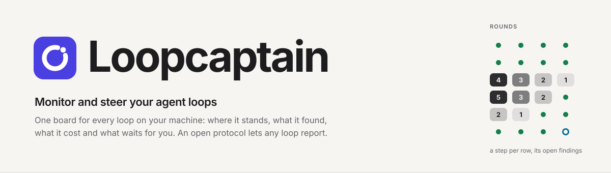
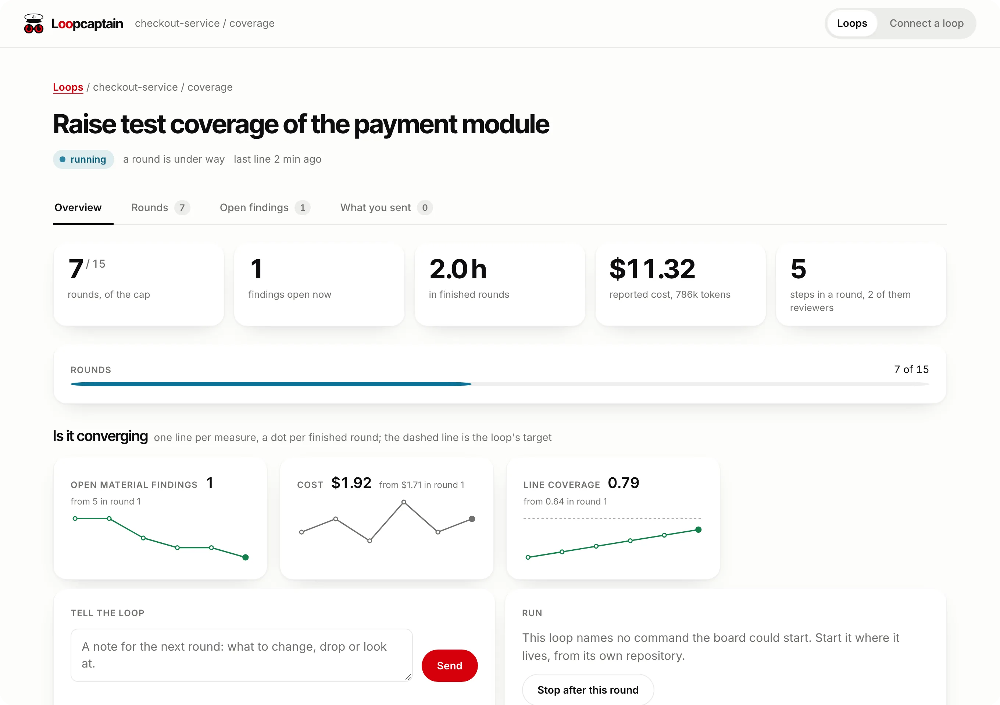
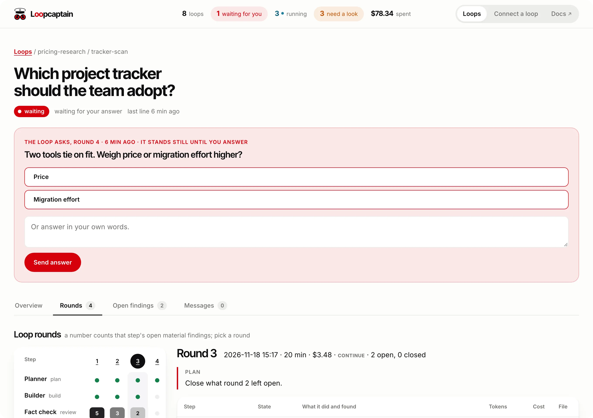

<!-- Banner and how-it-works picture are drawn by scripts/readme_assets.py, light and dark: make readme. -->
<picture>
  <source media="(prefers-color-scheme: dark)" srcset="docs/assets/banner-dark.svg">
  
</picture>

[](https://pypi.org/project/loopcaptain/)
[](Makefile#L46)
[](LICENSE)
[](https://www.python.org/downloads/)
[](https://docs.astral.sh/uv/)
[](https://docs.astral.sh/ruff/)
[](https://mypy-lang.org/)
[](standard/LOOPS.md#5-the-same-through-mcp)
[](https://pre-commit.com/)
[](https://github.com/gitleaks/gitleaks)

**Loopcaptain is an open protocol for agent loops and a local dashboard to
monitor and steer them.** You run agent loops in many repositories, each
built its own way. Here is the one place to see them: what each loop is
for, where it stands, what every round and every reviewer found, what it
cost, and what waits for you. You answer, stop and start a loop from the
board: a human in the loop without a chat window.

It works with any loop that can write a file: a script, a Ralph loop, a
long-running session of a coding agent (Claude Code's `/loop`, Codex's
goal mode, for example), a loop built on an agent framework. None of
them is needed: a loop has no dependency and never imports this
repository.

<picture><source media="(prefers-color-scheme: dark)" srcset="docs/assets/screenshot-overview-dark.webp"></picture>

<sub>Invented loops, photographed from the board itself: `make shots`.</sub>

## Get started

**Want to monitor the loops you already run?** Paste this into your coding
agent, whichever you use. It finds the loops on your machine, sets up the
board and proposes the smallest change that connects each one:

```text
Help me see and steer the agent loops on this machine with Loopcaptain.
Read https://github.com/faviens/loopcaptain/blob/main/AGENTS.md, section A.
Find the repositories here that run agent loops, tell me which already
write a .loops/ folder and which do not, set up the board to watch them,
start it, and for each loop that is not connected propose the smallest
change that connects it. Change nothing in those repositories before I agree.
```

**Want to set up a new loop that speaks the protocol?** Paste this one. It
asks what the loop is for, builds it in your repository and shows you one
real round on the board:

```text
Help me build an agent loop that reports to Loopcaptain.
Read https://github.com/faviens/loopcaptain/blob/main/standard/AGENTS.md and LOOPS.md beside it.
Ask me what the loop is for, who reads the result and when it is done.
Then design the roles of one round, write the loop in this repository,
make it write .loops/<loop-id>/ as the protocol says, and show me
`loopcaptain validate .` printing ok after one real round.
```

**Want to look first?** Install it and run the example loop, which costs
nothing (no model, no network):

```bash
uv tool install git+https://github.com/faviens/loopcaptain
loopcaptain demo && loopcaptain serve      # http://127.0.0.1:8484
```

It needs Python 3.12 or later and [uv](https://docs.astral.sh/uv/), on
macOS or Linux. From a checkout: `make setup && make demo && make serve`.
The documentation has [Installation](docs/installation.md),
[Get started](docs/get-started.md) and [Setup](docs/setup.md).

## The loop protocol

A loop does not import this repository. It writes a few small files into
`.loops/<loop-id>/` in its own repository; the board reads them and writes
the person's answers back.

| File | Written by | Holds |
|---|---|---|
| `loop.json` | the loop | what it is: the brief, the steps of a round, its caps, its start command |
| `events.jsonl` | the loop, appending | what happened: rounds, steps, findings, cost, metrics, questions |
| `inbox.jsonl` | the board, signed | what you sent: answers, notes, a stop |

The whole protocol is one page, [standard/LOOPS.md](standard/LOOPS.md). A
Python loop pastes a 60-line helper, [standard/loops.py](standard/loops.py);
an agent session uses the MCP server, which every coding agent adds its own
way: [docs/agents.md](docs/agents.md).

## Monitor an agent loop

1. **Every loop**, grouped by repository, filtered by status or text, with
   what waits for you on its own tab.
2. **One loop**: the brief, the graph of a round, whether it converges (a
   line per measure against its target), bars against its caps, every round
   against every step, open findings, the items it evaluates, and what you
   sent with whether the loop took it.
3. **Signs before the loop sees them**: a loop that stalled, one that goes
   round without getting closer, a step that needs you, a line it wrote
   that the protocol check refuses.

<p>
<picture><source media="(prefers-color-scheme: dark)" srcset="docs/assets/screenshot-waiting-dark.webp"></picture>
<picture><source media="(prefers-color-scheme: dark)" srcset="docs/assets/screenshot-loop-dark.webp"></picture>
</p>
<p>
<picture><source media="(prefers-color-scheme: dark)" srcset="docs/assets/screenshot-rounds-dark.webp"></picture>
<picture><source media="(prefers-color-scheme: dark)" srcset="docs/assets/screenshot-findings-dark.webp"></picture>
</p>

## Steer a loop: answer, note, stop, start

1. **Answer.** A loop that asks shows its question on the board, with
   buttons where it offered choices. Your answer is one signed line in the
   loop's `inbox.jsonl`; the loop reads it at its next round.
2. **Note.** The same line without a question: a direction for the next
   round.
3. **Stop.** The loop finishes the round it is in and ends.
   `loopcaptain doctor` checks that a loop really takes a stop.
4. **Start.** The board runs the one command the loop declared in its own
   `loop.json`, without a shell, after you tick it once.

## Connect a loop you already have

1. **A script** (Python, shell, anything): paste the helper from
   [standard/LOOPS.md](standard/LOOPS.md) and call it where a round and a
   step begin and end, or append the JSON lines yourself.
2. **A Ralph loop or any loop around an agent's command line:** the shell
   form, `loopcaptain emit <loop> <event> key=value`, once per iteration.
3. **A long-running agent session:** add the MCP server
   (`loopcaptain mcp-config <agent>`), and the session reports its rounds
   through five tools.

[standard/AGENTS.md](standard/AGENTS.md) walks an agent through each, and
through building a loop from nothing.

## Commands

```bash
loopcaptain serve                         # the board, 127.0.0.1 only
loopcaptain watch <folder> [--root]       # show a repository, or every one under a folder
loopcaptain demo                          # the example loop, written and watched
loopcaptain validate <repository>         # check a repository's .loops folders
loopcaptain doctor <repository> <loop>    # does the loop take a stop?
loopcaptain mcp-config <agent>            # how your agent adds the MCP server
loopcaptain emit <loop> <event> key=value # one event from a shell loop
```

From a checkout, put `uv run` in front, or use the `make` targets in
[AGENTS.md](AGENTS.md).

## How it differs

1. **A dashboard for one kind of loop** watches the loops of its own
   runner. Loopcaptain watches any loop that writes the protocol's files.
2. **A session monitor** shows an agent's live session and its transcript.
   Loopcaptain shows what sits above: rounds, steps, findings, verdicts,
   cost and the question that waits for you.
3. **A loop runner or control plane** runs the loop. Loopcaptain runs
   none: it is a protocol and a board, and your loop stays your own.
4. **Agent observability** traces model calls. Loopcaptain sends and takes
   no telemetry; [docs/opentelemetry.md](docs/opentelemetry.md) maps the
   protocol onto the GenAI conventions for those who want both.

## What it is not

No agent runtime: the board runs no model and schedules nothing; it starts
only the one command a loop declares, after you tick it once. No database:
the files are the truth. No cloud and no login: it answers on 127.0.0.1
only. No transcripts: a loop reports summaries and paths. See
[SECURITY.md](SECURITY.md) for what it trusts.

## More

[AGENTS.md](AGENTS.md) runs the board and changes this repository.
[docs/ARCHITECTURE.md](docs/ARCHITECTURE.md) says why it is built this way.
[CHANGELOG.md](CHANGELOG.md) says what changed.

## License

[Apache License 2.0](LICENSE): use it, change it and ship it, also
commercially; keep the licence and the [NOTICE](NOTICE), and say what you
changed. It comes with a patent grant from every contributor. A
contribution is taken under the same licence.
