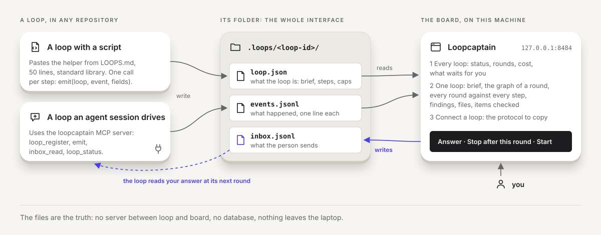
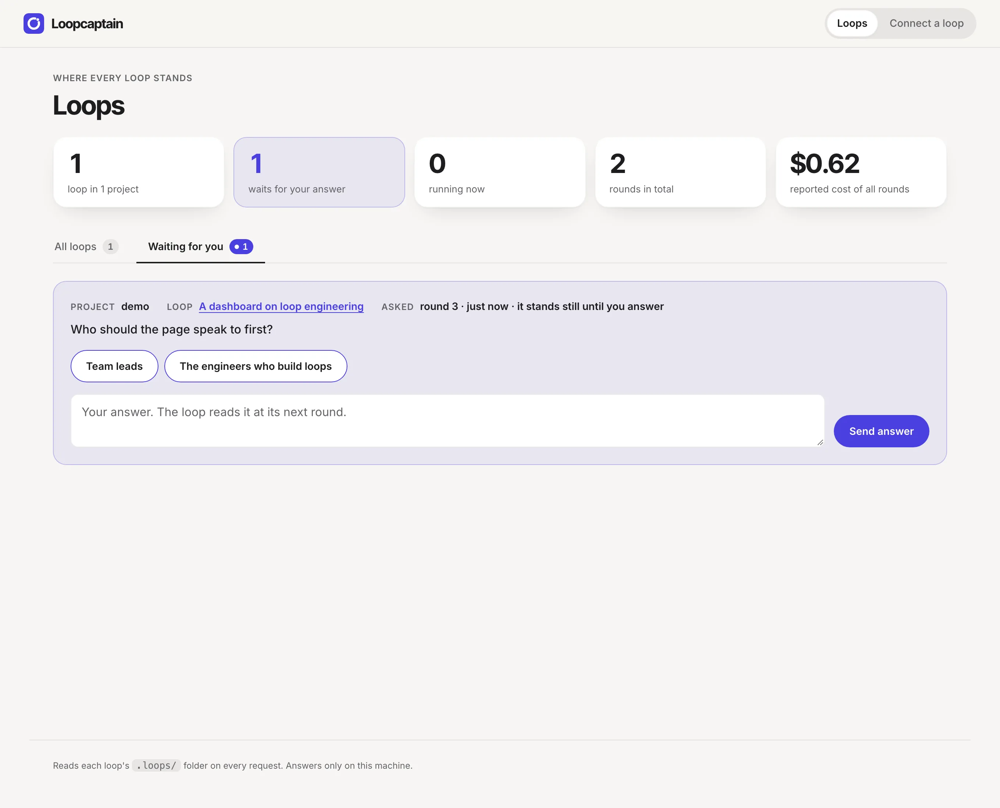
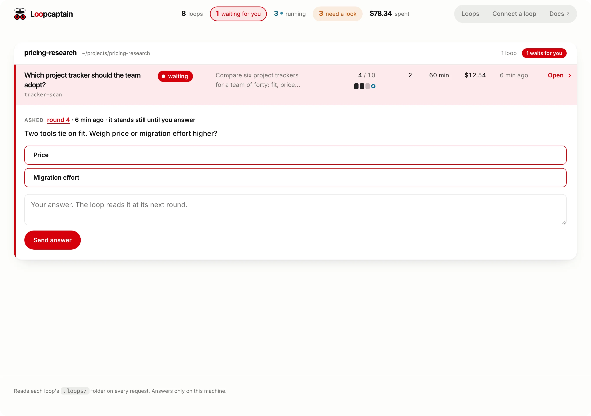
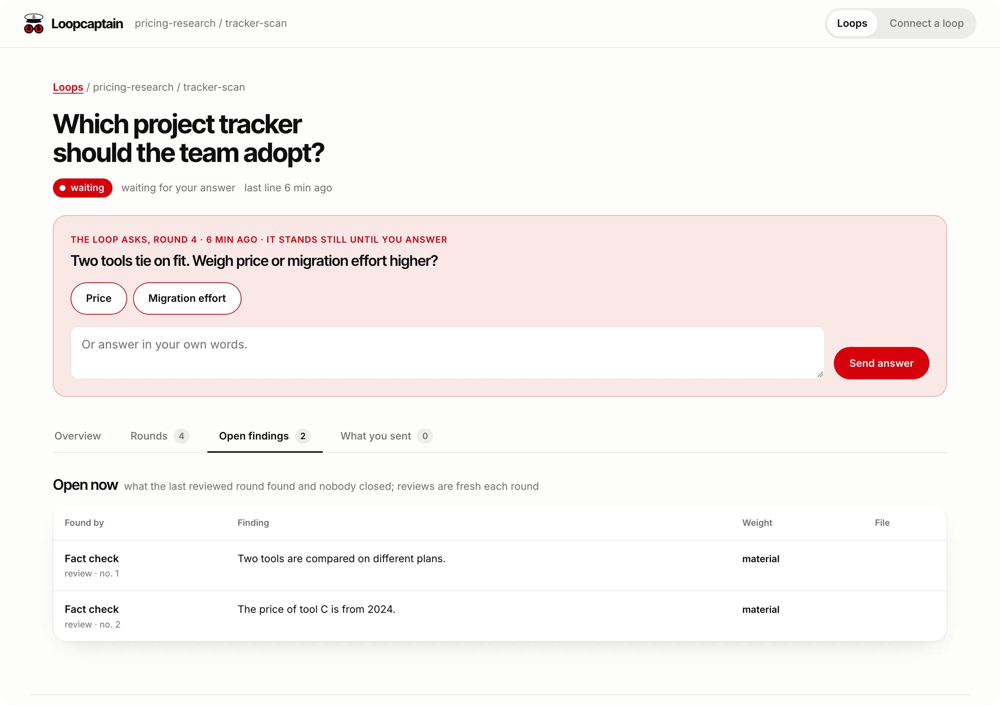

<!-- Banner and how-it-works picture are drawn by scripts/readme_assets.py, light and dark: make readme. -->
<picture>
  <source media="(prefers-color-scheme: dark)" srcset="docs/assets/banner-dark.svg">
  
</picture>

[](https://github.com/faviens/loopcaptain/actions/workflows/ci.yml)
[](https://faviens.github.io/loopcaptain/)
[](https://pypi.org/project/loopcaptain/)
[](https://www.python.org/downloads/)
[](LICENSE)

**Loopcaptain is an open protocol for agent loops and a local dashboard to
monitor and steer them:** a human in the loop without a chat window. Alpha:
protocol 1 only grows, so a loop written today keeps working; the board may
change.

<picture>
  <source media="(prefers-color-scheme: dark)" srcset="docs/assets/hero-dark.svg">
  
</picture>

## Get started

Paste one line into your coding agent, whichever you use.

### Start a new loop

```text
Use Loopcaptain to build an agent loop in this repository: follow https://github.com/faviens/loopcaptain/blob/main/standard/AGENTS.md.
```

### Connect a loop you have

```text
Connect the agent loops on this machine to the Loopcaptain board: follow https://github.com/faviens/loopcaptain/blob/main/AGENTS.md, section A.
```

## The board

Every loop on your machine on one page: what waits for you, what needs a
look, what runs, what it cost. One loop in detail: whether it converges,
every round and what each reviewer found, and where you answer, steer, stop
or start it.

<picture><source media="(prefers-color-scheme: dark)" srcset="docs/assets/screenshot-overview-dark.webp"></picture>

<p>
<picture><source media="(prefers-color-scheme: dark)" srcset="docs/assets/screenshot-waiting-dark.webp"></picture>
<picture><source media="(prefers-color-scheme: dark)" srcset="docs/assets/screenshot-loop-dark.webp"></picture>
</p>
<p>
<picture><source media="(prefers-color-scheme: dark)" srcset="docs/assets/screenshot-rounds-dark.webp"></picture>
<picture><source media="(prefers-color-scheme: dark)" srcset="docs/assets/screenshot-findings-dark.webp"></picture>
</p>

<sub>Invented loops, photographed from the board itself: `make shots`.</sub>

## Setup

```bash
uv tool install loopcaptain    # or put uvx in front of the two lines below
loopcaptain demo               # writes the example loop and puts it on the board
loopcaptain serve              # the board, on this machine only
```

Open the address `serve` prints in a browser: it lets that browser in. The
example loop costs nothing, no model and no network: press Start, answer
its question with a button and watch it end `done`. It needs Python 3.12 or
later, on macOS or Linux, and [uv](https://docs.astral.sh/uv/), pipx or pip.
From a checkout: `make setup && make demo && make serve`.

It works with any loop that can write a file: a script, a Ralph loop, a
long-running session of a coding agent (Claude Code's `/loop`, Codex's goal
mode, for example), a loop built on an agent framework. None of them is
needed: a loop has no dependency and never imports this repository. The
[documentation](https://faviens.github.io/loopcaptain/) has
[Installation](https://faviens.github.io/loopcaptain/installation/),
[Get started](https://faviens.github.io/loopcaptain/get-started/) and
[Setup](https://faviens.github.io/loopcaptain/setup/).

## Steer a loop: answer, note, stop, start

1. **Answer.** A loop that asks shows its question on the board, with
   buttons where it offered choices. Your answer is one signed line in the
   loop's `inbox.jsonl`; the loop reads it at its next round.
2. **Note.** The same line without a question: a direction for the next
   round.
3. **Stop.** The loop finishes the round it is in and ends.
   `loopcaptain doctor` checks that a loop really takes a stop.
4. **Start.** The board runs the one command the loop declared in its own
   `loop.json`, without a shell, after you tick it once.

## The loop protocol

A loop does not import this repository. It writes a few small files into
`.loops/<loop-id>/` in its own repository; the board reads them and writes
the person's answers back.

| File | Written by | Holds |
|---|---|---|
| `loop.json` | the loop | what it is: the brief, the steps of a round, its caps, its start command |
| `events.jsonl` | the loop, appending | what happened: rounds, steps, findings, cost, metrics, questions |
| `inbox.jsonl` | the board, signed | what you sent: answers, notes, a stop |

The whole protocol is one page, [standard/LOOPS.md](standard/LOOPS.md). A
Python loop pastes a helper of under 110 lines, [standard/loops.py](standard/loops.py);
an agent session uses the MCP server, which every coding agent adds its own
way: [docs/agents.md](docs/agents.md).

An agent loop runs an agent on one task again and again, until a bar is met
or a cap is reached. One pass is a round: a few steps, usually one that
makes something and others that judge it. A reviewer is such a judging
step: it reads what the round made and lists what is wrong, as findings. A
loop reports by appending one line per thing that happened to
`.loops/<loop-id>/events.jsonl`. One round, in which a reviewer finds a
fault and the loop asks you what to do:

<!-- The lines below are checked by tests/test_docs.py: they validate as written. -->
```json
{"ts": "2026-11-14T21:03:00Z", "event": "round_started", "round": 1, "plan": "Draft the memo"}
{"ts": "2026-11-14T21:09:40Z", "event": "step_finished", "round": 1, "step": "build", "cost": {"usd": 0.34}}
{"ts": "2026-11-14T21:12:10Z", "event": "step_finished", "round": 1, "step": "facts", "findings": [{"id": "1", "text": "The 40 percent has no source", "severity": "material"}]}
{"ts": "2026-11-14T21:12:30Z", "event": "step_finished", "round": 1, "step": "gate", "passed": false, "summary": "One material finding is open"}
{"ts": "2026-11-14T21:12:31Z", "event": "question", "id": "q1", "text": "Drop the figure?", "options": [{"id": "yes", "label": "Drop it"}, {"id": "no", "label": "Find a source"}]}
{"ts": "2026-11-14T21:12:32Z", "event": "round_finished", "round": 1, "verdict": "wait"}
```

## Connect a loop by hand

1. **A script** (Python, shell, anything): paste the helper from
   [standard/LOOPS.md](standard/LOOPS.md) and call it where a round and a
   step begin and end, or append the JSON lines yourself.
2. **A Ralph loop or any loop around an agent's command line:** the shell
   form, `loopcaptain emit <loop> <event> key=value`, once per iteration.
3. **A long-running agent session:** add the MCP server
   (`loopcaptain mcp-config <agent>`), and the session reports its rounds
   through five tools.

[standard/AGENTS.md](standard/AGENTS.md) walks an agent through each, and
through building a loop from nothing.

## Commands

```bash
loopcaptain serve                         # the board, 127.0.0.1 only
loopcaptain watch <folder> [--root]       # show a repository, or every one under a folder
loopcaptain demo                          # the example loop, written and watched
loopcaptain validate <repository>         # check a repository's .loops folders
loopcaptain doctor <repository> <loop>    # does the loop take a stop?
loopcaptain mcp-config <agent>            # how your agent adds the MCP server
loopcaptain emit <loop> <event> key=value # one event from a shell loop
```

From a checkout, put `uv run` in front, or use the `make` targets in
[AGENTS.md](AGENTS.md).

## How it differs

1. **A dashboard for one kind of loop** watches the loops of its own
   runner. Loopcaptain watches any loop that writes the protocol's files.
2. **A session monitor** shows an agent's live session and its transcript.
   Loopcaptain shows what sits above: rounds, steps, findings, verdicts,
   cost and the question that waits for you.
3. **A loop runner or control plane** runs the loop. Loopcaptain runs
   none: it is a protocol and a board, and your loop stays your own.
4. **Agent observability** traces model calls. Loopcaptain sends and takes
   no telemetry; [docs/opentelemetry.md](docs/opentelemetry.md) maps the
   protocol onto the GenAI conventions for those who want both.

## What it is not

No agent runtime: the board runs no model and schedules nothing; it starts
only the one command a loop declares, after you tick it once. No database:
the files are the truth. No cloud and no login: it answers on 127.0.0.1
only, and to a browser that opened the address `serve` prints. No transcripts: a loop reports summaries and paths. See
[SECURITY.md](SECURITY.md) for what it trusts.

## More

[AGENTS.md](AGENTS.md) runs the board and changes this repository.
[docs/ARCHITECTURE.md](docs/ARCHITECTURE.md) says why it is built this way.
[CHANGELOG.md](CHANGELOG.md) says what changed.

## License

[Apache License 2.0](LICENSE): use it, change it and ship it, also
commercially; keep the licence and the [NOTICE](NOTICE), and say what you
changed. It comes with a patent grant from every contributor. A
contribution is taken under the same licence.
