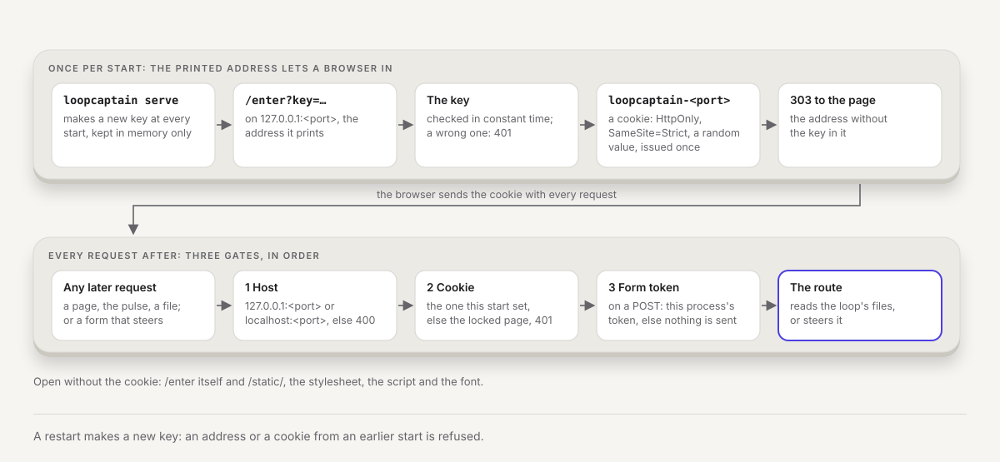
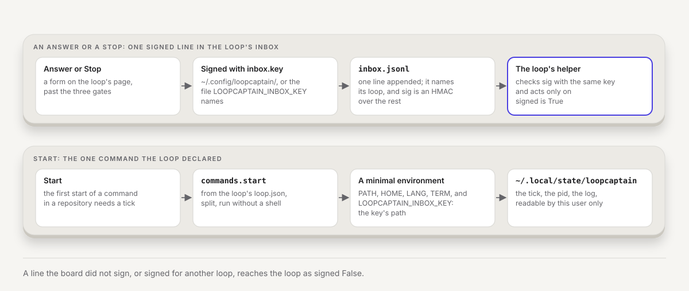
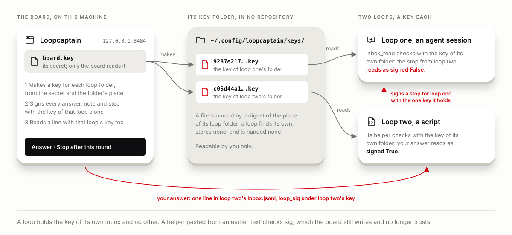

<!-- The site's copy, docs/security.md, takes the parts between these marks and draws the pictures from its own folder. -->
<!-- --8<-- [start:head] -->
# Security

## Threat model

How a browser gets into the board, and how an answer, a stop or a start
reaches a loop:

<!-- --8<-- [end:head] -->
<picture>
  <source media="(prefers-color-scheme: dark)" srcset="docs/assets/entry-dark.svg">
  
</picture>

<picture>
  <source media="(prefers-color-scheme: dark)" srcset="docs/assets/steer-dark.svg">
  
</picture>

<picture>
  <source media="(prefers-color-scheme: dark)" srcset="docs/assets/keys-dark.svg">
  
</picture>

<!-- --8<-- [start:model] -->
1. **Trusted:** the person at the board, the board's own config
   (`loopcaptain.local.yaml` or `~/.config/loopcaptain/config.yaml`) and its
   state folder. The state folder holds which start commands were ticked
   and which processes the board started; it is the person's own
   (`$XDG_STATE_HOME/loopcaptain`, else `~/.local/state/loopcaptain`, or
   the folder `LOOPCAPTAIN_STATE` names), never a folder inside the place
   the board is started from, and its files are readable by the user only.
2. **Not trusted:** every file in a watched repository. A loop's
   `loop.json`, `events.jsonl` and any file a loop links to may be written
   by an agent. The board reads them bounded, follows no symbolic link in
   `.loops/`, and renders content only as escaped text or Markdown
   without HTML.
   Each repository and each loop is a boundary: one the board cannot
   enter, read or make sense of is named with the reason and left out,
   and every other loop stays readable and steerable.
3. **The file viewer:** it opens only text files that a loop names: in
   its `loop.json`, in its events, or as an argument of its start command,
   and the loop's own three files. Any other file of a watched repository
   is not opened, whatever its name, and nothing outside the repository
   is. It never shows `.git`; of git's own files the board reads only the
   branch's name and which repository a worktree belongs to, from disk,
   without running `git`. Of the files a loop names, the viewer still
   refuses a block-list of names under which tools commonly keep keys,
   tokens and passwords (`PRIVATE_PARTS` and `PRIVATE_PATTERNS` in
   `src/loopcaptain/board/files.py`). A loop decides what it names: one
   that names a config file with a password in it has that file shown.
   Watch only repositories whose loops you would let read their text
   files to you.
4. **The one command it runs:** `commands.start` of a loop's `loop.json`,
   when the person presses Start, split into arguments with no shell, with
   only `PATH`, `HOME`, `LANG` and `TERM` from the board's environment,
   and `LOOPCAPTAIN_INBOX_KEY` saying where the board's keys are. The
   first start of a command for a loop needs a tick; a command with
   characters that do not show is never started, and the page names a
   script that changed since the last start. Do not put a
   folder of repositories you have not read under `roots:`.
5. **The inbox:** the board signs every line it writes with a key of that
   loop alone, naming the loop, so a loop can tell the person from an
   agent that writes files in its repository. The keys are files in
   `~/.config/loopcaptain/`: `board.key`, the secret every loop's key is
   made from, which only the board reads, and `keys/`, one file per loop
   folder, which that loop reads. A loop that holds its key can sign for
   its own inbox and for no other loop's. The board's own status ignores
   a line whose signature fails. `inbox.key`, the one key of earlier
   versions, still signs a second mark, `sig`, for loops with a helper
   pasted from an earlier text: whoever holds it can deceive such a loop,
   and no other loop and not the board. The board takes a line under
   that key as its own only if the inbox already held it when the board
   first made the loop's key; the date a line claims counts for nothing.
   A process with the user's full file access can read all of these too.
6. **The network:** the board listens on `127.0.0.1` only and answers only
   to its own host name. No page loads anything from another origin.
   Nothing is sent off the machine.
7. **Who may use it:** every request, reading a page included, needs the
   session cookie that the address printed by `loopcaptain serve` sets;
   only the stylesheet, the script and the font are served without it.
   Each start makes a new key, kept in the board's memory only, so an
   address or a cookie from an earlier start is refused. Every form also
   carries a per-process token. The printed address works once: it lets
   one browser in, which stays in while that board runs, and is refused
   after that, so a copy left in a history, a scrollback or a transcript
   lets nobody in. Another browser needs a restart of `serve`.
8. **What that does not cover:** a process that runs as you and can read
   your terminal, your browser's cookie store or the board's memory can
   get in, as it can read the watched repositories and the board's keys
   directly. The boundary is between you and everything else that can
   reach the port: other accounts on the machine, a container on the host
   network, a forwarded port, a process confined to its own folder.
   A browser sends a cookie for `127.0.0.1` to every port there, so
   another web server on `127.0.0.1` that you open in the same browser
   receives the board's cookie while that board runs; the cookie, like the
   key, changes at each start.

## Reporting a vulnerability

Report privately through the repository's security advisories:
`https://github.com/faviens/loopcaptain/security/advisories/new`. Please do not open a public
issue. Expect an answer within a week.
<!-- --8<-- [end:model] -->
