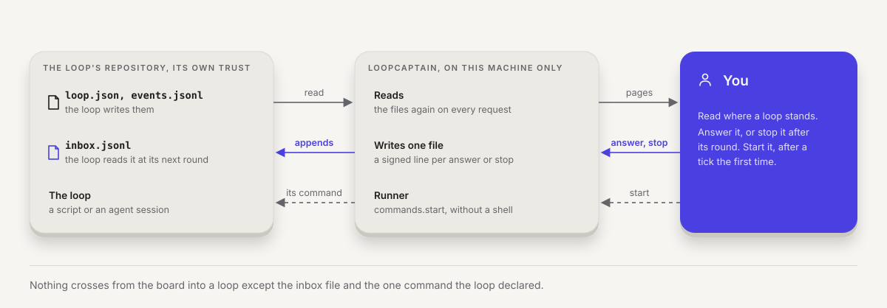
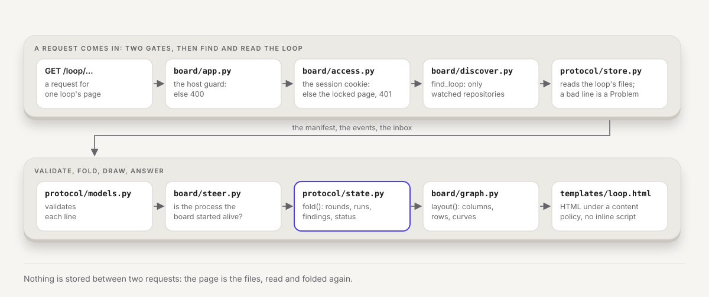
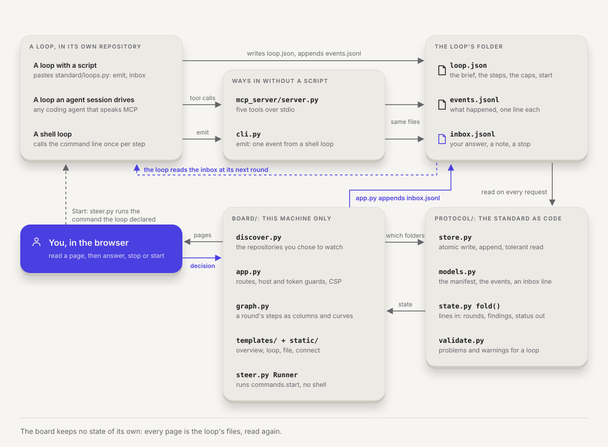
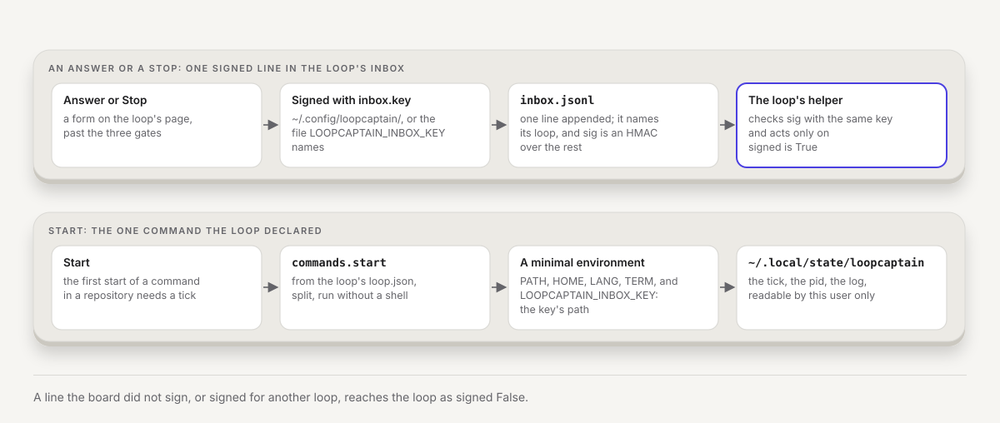
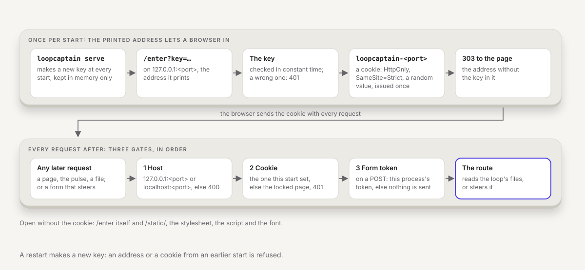
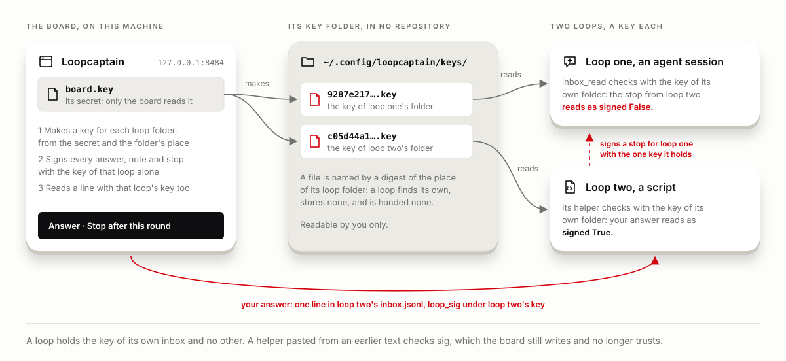

# Architecture

Why Loopcaptain is built the way it is. One section per decision; a changed
decision gets a new section that names the one it replaces.

<!-- Every picture on this page is drawn by scripts/readme_assets.py, light and dark: make readme. -->
<picture>
  <source media="(prefers-color-scheme: dark)" srcset="assets/trust-dark.svg">
  
</picture>

The filled tile is where a person decides. Nothing crosses from the board
into a loop except through the inbox file and the one start command the
loop declared for itself.

How one page comes about, file by file:

<picture>
  <source media="(prefers-color-scheme: dark)" srcset="assets/request-dark.svg">
  
</picture>

## The parts, file by file

Every tile is a file or a process you can open. A loop writes two files
and reads the third; the board reads all three on every request and
writes only the inbox.

<picture>
  <source media="(prefers-color-scheme: dark)" srcset="assets/parts-dark.svg">
  
</picture>

The two tiles with the coloured border carry the logic: `fold` turns lines
into a loop's state, and the board's routes are the only way from a browser
to a file. The coloured arrows are the only two ways back into a loop: the
inbox file and the start command the loop declared for itself. The sections
below give the reason for each choice and what was rejected.

## 1. The interface is a folder of files in the loop's repository

**Decision.** A loop shows up by writing `.loops/<loop-id>/loop.json`
and appending to `events.jsonl`; the board appends to `inbox.jsonl`. The
text is `standard/LOOPS.md`, the code `src/loopcaptain/protocol/`.

**Why.** The loops this was built for are scripts in several repositories,
each with its own layout of round folders. What they share is small: a
brief, roles that run in an order, rounds, a file and a verdict per step,
a cost, and a question for the person. Appending one line at the places a
loop already has costs a handful of calls and no dependency, in any
language. Public loop projects have these parts many times over, and no
shared file format with a manifest, verdicts per round, findings and an
item matrix.

**Rejected.**
1. A Python package the loops import and call with typed models: couples
   every loop repository to this one and excludes loops in other
   languages.
2. One rich export file rewritten at the end of every round: a crash
   mid-round shows nothing, two writers race, and the loop must hold the
   whole state to write it.
3. A server the loops post to: a second thing to run, and nothing to show
   when it was not running.
4. Adapters in the board that parse each loop's own files: the board
   would know every loop's layout and break when one changes.
5. Adopting an existing runner (ralph-orchestrator): it shows only loops
   it runs, its gates are tests and lint, and it has no rounds, persistent
   findings or item matrix. Four of its ideas were taken (sections 5, 6).

## 2. Events are appended and folded; nothing is stored twice

**Decision.** `events.jsonl` is append-only. `protocol/state.py` folds
manifest, events and inbox into a `LoopState` on every request; status is
derived, never written. A line the models refuse is reported and skipped.

**Why.** An append cannot corrupt what is already there, a half-written
last line is simply not read yet, and the log doubles as the history. A
pure fold with the clock as an argument makes every status rule a test.

**Rejected.** A database or a cache in the board: a second truth that can
disagree with the files, for loops that write a few hundred lines.

## 3. A script writes the files itself; an agent session writes them through MCP

**Decision.** `src/loopcaptain/mcp_server/server.py` exposes the protocol as
five MCP tools (`protocol`, `loop_register`, `emit`, `inbox_read`,
`loop_status`) that write the same files as the pasted helper and use its
verbs. Scripts do not use it.

**Why.** A loop that an agent session drives has no script to put calls
into; MCP is the portable way in. Everything else is better served by the
script writing its own lines: models skip bookkeeping calls, and tool
definitions cost context. Headless runs load the same MCP configuration as
an interactive session, so an unattended agent can use the tools too.

**Rejected.** MCP as the only interface: every scripted loop would need an
MCP client, and the state would live with a server. One typed tool per
event (twelve tools): more to load into every session, and a second
vocabulary beside the helper's.

## 4. The board is server-rendered, local, and reads fresh

**Decision.** FastAPI with Jinja templates, one stylesheet, one small
script, vendored fonts; bound to 127.0.0.1; every request reads the files
again. No build step, no framework, no CDN.

**Why.** Three pages over a few small files need no client state. Nothing
fetched from elsewhere means nothing about a loop leaves the laptop, and a
strict content policy (`default-src 'self'`) is possible because no page
carries inline script or style.

**Rejected.** A single-page app: a build step and a second copy of the
state. A static export: no reply box.

## 5. Steering is an inbox file and one declared command

**Decision.** The answer box and "Stop after this round" append to
`inbox.jsonl`; the loop reads it at the start of a round and marks entries
read with `inbox_read`. "Start" runs `commands.start` from the loop's own
`loop.json`, split into arguments, without a shell, in the loop's
repository (`board/steer.py`). Every changing request carries the server
process's token, and every request must name the server as host. A
`question` may say that it blocks and for how long.

**Why.** The person steers without knowing where a loop keeps its thread
file. The loop stays in charge of what it does with a reply. A browser
that can run only what the loop's repository declared cannot be turned
into a shell by another web page.

**Rejected.** Writing the reply into the loop's own files: the board
would need each loop's format. Running a command typed in the browser.
Killing as the normal stop: a round's work would be lost; the board
offers it only for a process it started itself.

## 6. Steps are plain data: no vendor, no runtime

**Decision.** A step has an id, a kind, and free-text `backend` and
`model`; order comes from the list, `after` where a step does not follow
the one before. Caps (`round_cap`, `runtime_cap_minutes`, `cost_cap_usd`)
are the loop's own; the board shows them and marks an idle loop that
reached one as capped. `standard/templates/` holds three manifests to
copy.

**Why.** The board must work with any runner and any agent. `after` draws
every graph the known loops have (a sequence, a fan of reviewers, a gate
that joins them) with one optional field.

**Rejected.** Steps that declare the events they wait for and emit: more
general, and a second vocabulary to learn for a picture the board can
already draw. The board enforcing caps: it does not run the loop.

## 7. Reviews are fresh each round

**Decision.** What is open is what the last reviewed round's steps found
and nobody closed (`LoopState.open_findings`). A finding has an id within
its step and round, a text and a severity, `material` or `minor`.

**Why.** It is how the known loops review: fresh agents each round, a
count of material gaps per reviewer. It needs no identity of a finding
across rounds.

**Rejected for now.** Stable fingerprints that follow a finding across
rounds and four severities: `.agent/FINDINGS.md` (F5, F7).

## 8. One standard folder, neutral and copyable

**Decision.** `standard/` holds what another repository needs: the text,
the helper, templates, the JSON Schema, and an `AGENTS.md` that tells an
agent how to make a loop meet it. The spec has that one home; the package
carries a copy when built. Nothing in the repository names a company or a
client (`tests/test_neutral.py`).

**Why.** Connecting a loop is one sentence and one link, and the project
is meant to be opened to others.

**Rejected.** The spec inside the package folder: correct for Python,
invisible to someone browsing the repository.

## 9. The look: calm, one action colour, status by shape

**Decision.** `board/static/style.css` starts from tokens: a warm light
canvas and true black in dark mode, soft surfaces, one action colour
(iris) for links, the answer button and "waiting for you", Inter Tight
over Inter, a 12/14/16/20/26/36 scale, 4/8-point spacing, 44 px controls.
Status has its own colours and its own shapes. Open findings are an ink
ramp. The logo is `static/mark.svg`.

**Why.** The page exists to show the one thing that needs the person;
everything else has to be quiet for that to work, and it has to read
without colour.

**Rejected.** A red accent for both "needs you" and "finding": the two
would compete on every page.

## 10. What this is not, and what sits beside it

**Decision.** No agent runtime, no scheduler, no transcript store, no
cloud, no login, no GitHub API. Loops that run on a CI service appear
once their checkout holds a `.loops/` folder.

**Why.** Session boards from vendors already cover live sessions; a
dashboard of CI agent runs is a different tool that reads a hosting
service. The part nobody else has is the file format across runners.

## 11. The on-disk names are plain, the outcome of a round is two fields

**Decision.** A loop's folder is `.loops/<loop-id>/` and the text is
`standard/LOOPS.md`, "the loops protocol"; neither carries the name of this
application. A sub-folder is a loop only if its `loop.json` has the
`protocol` field. `round_finished` carries `verdict` (continue, done, wait,
stopped, failed) and an optional `stop_reason` (goal_met, round_cap,
cost_cap, runtime_cap, person, no_progress, error); `finding_closed`
carries an optional `resolution` (fixed, accepted, wontfix, false_positive,
duplicate). The text ends with what a loop and a board MUST, SHOULD and MAY
do, and how versions grow.

**Why.** The application's name is not settled and a protocol should
outlive the tool that reads it, like `.github/`. Other tools already keep
files under `.loops/`, so the `protocol` field is what marks a loop.
`stopped` alone could not tell a person's stop from a cap, and nothing
said "waiting for the person"; closing a finding could not tell fixed from
waved off. Both are one optional field with a closed list of values.

**Rejected.** A folder named after the application: it would have to
change with the name. Free text for the reason: a board cannot show it as
a status. The wider vocabulary of other loop tooling (control roles,
criteria ids, gates as data, run ids): each is a word every loop author
must learn, and unknown fields are already allowed.

## 12. The board signs the inbox; a loop decides what to do with an unsigned line

**Decision.** Every line the board appends to `inbox.jsonl` carries `sig`,
an HMAC-SHA256 over the line without `sig` in a canonical JSON form. The
key is `~/.config/loopcaptain/inbox.key` (or the file `LOOPCAPTAIN_INBOX_KEY`
names), created when `serve` starts, readable by the user only, outside every
watched repository (`protocol/signing.py`). The helper and the MCP tool
`inbox_read` add `signed` to each entry: true, false, or null where the
machine has no key. `sig` is an optional field of protocol 1. Starting a
loop passes only `PATH`, `HOME`, `LANG` and `TERM`, so the key's path is
not handed over in the environment either.

**Why.** The inbox is a plain file in the loop's repository. A loop whose
agents write files could not tell the board's `reply` from an agent's, and
a forged `stop` would end the run (F14 g). A signature keeps the inbox
where every loop already reads it, and the helper stays standard library.

**Rejected.** An inbox outside the repository: every loop would need to
learn a second path, and a loop on another machine could not read it. A
public-key signature: the standard library has no Ed25519, and the helper
must stay a paste. Refusing unsigned lines in the board's own fold: the
board shows what is in the file; acting on it is the loop's decision.
What it does not stop: a process with the user's full file access can
read the key. It guards against agents confined to their repository.

## 13. Worktrees of one repository are one repository

**Decision.** `board/discover.py` groups the folders it finds by the `.git`
folder they share, read from the `.git` file of a worktree without running
git. A group shows once, from the worktree whose `.loops/` was written
last; the loop page names it and lists the others in a tooltip.

**Why.** A loop that runs in its own worktree, as the "one worktree per
writer" rule asks, sits beside the main checkout under the same root. The
board listed each of its loops twice, from copies that disagreed, and a
person could steer the stale one.

**Rejected.** `git rev-parse --git-common-dir` per folder: a process per
repository on every request, where one small file read answers the same.
Merging the copies' events: two folders are two truths, and the last
written one is the one a running loop writes.

## 14. Protocol 1 grows by what real loops and published practice need

**Decision.** Optional fields and three events, all in protocol 1:
`at` on any event (when it happened, beside `ts`, when it was written);
`cost` on `round_finished` (the round's sum) with cache tokens, turns and
`estimated`; `metrics` on steps and rounds; `attempt`, `error` and
`session` on `step_finished`; `outcome`, `next_at` and the stop reason
`impossible` on `round_finished`; `id` and `options` on `question`, with
`question` and `choice` on a reply; `workspace` and `state` in
`loop.json`; the events `question_closed`, `loop_stopped` and
`heartbeat`. The fold (`protocol/state.py`) measures time on `at`, shows
a loop that said when it is back as `sleeping`, and turns an error of
kind `needs_person` into something that waits for the person.

**Why.** The first real loop could not report a round's cost as a sum,
end a question it settled itself, stop between rounds without rewriting
the last verdict, or keep real times when it reported after the fact
(F14). Published loop practice adds a measure per round
(autoresearch, harness design), sleeping schedules, questions with
choices, errors only a person can fix, cache-heavy token use without a
price, and discarded experiments. Every addition is optional, so a loop
written against the earlier text still validates.

**Rejected.** `round_finished` without `round` for a stop between rounds:
it would make the most important field of the most important event
optional. A `supersedes` field on `question`: a loop that settles a
question elsewhere has no new question to ask. Protocol 2: nothing here
breaks a loop of today. Finding fingerprints (F5): no real loop has asked
for them yet.

## 15. No OpenTelemetry code; a mapping instead, and the files are the interface

**Decision.** Loopcaptain sends and takes no telemetry. `docs/opentelemetry.md`
maps the protocol onto the OpenTelemetry GenAI conventions, marked as
following a draft. A loop that runs elsewhere syncs its `.loops/` folder
to where the board reads; the board stays local. An exporter that tails
`events.jsonl` and sends OTLP is a finding (F15), to build when someone
wants loops beside agent traces in one place.

**Why.** The GenAI agent conventions are in development status and moved
to their own repository, `open-telemetry/semantic-conventions-genai`,
without a stable release (that repository, read 2026-11-14):
code against them breaks, a table is cheap to change. The agents already
emit telemetry for each model call, tokens and cost included, at the
source. What Loopcaptain adds is the layer above, rounds, steps, findings,
verdicts and questions, which no convention models. Taking spans in would
need a port and a store, a second truth that section 2 rejects. Sending
spans out is the first thing that would move data off the machine, so it
belongs in a separate, optional process.

**Rejected.** An OTLP receiver in the board: a server and a store. An
exporter inside the board: data leaves the machine from the process that
promises it does not. A connector per platform: any backend that takes
OTLP is served by one exporter.

## 16. The board's own status trusts only signed lines, and a line names its loop

Replaces part of section 12, which rejected refusing unsigned lines in the
board's fold.

**Decision.** `fold` takes the ids of inbox entries whose signature fails
(`signing.untrusted_ids`). They are listed on the "What you sent" tab, but
answer no question, clear no "needs you" and request no stop. Each line
the board writes carries `loop`, inside the signed body, and a line for
another loop does not verify. `serve` makes the key before it opens
(`cli.py`), so a loop on a machine that runs the board can tell lines apart
from the start. Where a machine has no key, nothing can be told apart
and every line counts, as before. The key is written
whole and linked into place, and a key shorter than 32 bytes is not used.

**Why.** An independent review found that a reply an agent wrote into its
own repository's inbox turned a waiting loop to idle: the person was no
longer asked, though the line showed as "not from the board". A signed
stop copied from one loop's inbox into another's verified there too.

**Rejected.** Hiding unsigned lines: the person should see that someone
wrote into the inbox. Binding the line to the repository's path as well:
a repository moved or cloned elsewhere would lose every signature, and a
loop id is unique within the repositories one person watches.

## 17. A started loop gets the key's path; a stop in a round that met its goal is `done`

Replaces the last sentence of section 12's decision.

**Decision.** Start passes `LOOPCAPTAIN_INBOX_KEY` beside `PATH`, `HOME`,
`LANG` and `TERM` (`board/steer.py`). A stop read during a round ends it
with its real verdict: `done` if the goal was met, else `stopped`; a stop
read between rounds is `loop_stopped`. `doctor` accepts all three. The
helper writes `ts` to the millisecond.

<picture>
  <source media="(prefers-color-scheme: dark)" srcset="assets/steer-dark.svg">
  
</picture>

**Why.** A first loop built from nothing by a fresh agent, given only the
first prompt, stumbled here: with a key at a custom path the started
loop could not check a signature and acted on any line; the spec's own
example loop broke out on a stop without saying so and failed `doctor`;
nothing said which verdict wins when a stop and the goal meet; a loop of
plain functions finishes a round within a second, so whole-second times
made every honest round look written after the fact.

**Rejected.** Keeping the key's path from a started loop: the path is not
the key, and the loop needs it to tell the person from its own agents.
`stopped` over `done`: the board would report a goal not met that was.

## 18. Apache License 2.0 for the code and the standard

**Decision.** Everything in the repository is under the Apache License 2.0:
`LICENSE` holds the text, `NOTICE` the copyright line and the fonts'
licence, `pyproject.toml` names all three as `license-files` so a built
package carries them, and `CITATION.cff` says the same. A contribution is
taken under the same licence (`CONTRIBUTING.md`); there is no contributor
agreement.

**Why.** A standard is adopted only if a company's lawyers can say yes
without a meeting. Apache 2.0 is permissive, widely pre-approved, and
carries an explicit patent grant from every contributor, which a protocol
others implement needs more than a library does.

**Rejected.** MIT: shorter, but silent on patents. A copyleft licence
(GPL, AGPL): a loop would hesitate to paste the helper. A source-available
licence: not open source, and no standard grows under one.

## 19. Releases are cut from the commits, not by hand

**Decision.** On every push to `main`, `.github/workflows/release.yml` runs
`scripts/release.py`. It reads the commits since the last tag: a `feat`
raises the minor version, a `fix` or `perf` the patch, a breaking change
the major (the minor before 1.0); anything else makes no release. The
workflow then builds the wheel with that version, smoke-tests it, and
creates the tag and the GitHub release with the commit subjects as notes
and the wheel attached. Nothing is committed back: `pyproject.toml` says
`0.0.0`.

**Why.** A version bumped and tagged by hand is a step that is forgotten
or done differently each time. The commits already say what changed and
how much, once their types are held to one meaning (AGENTS.md, "Commits
and pull requests"). Creating a tag needs only the workflow's permission
to write contents, which is set in the workflow file itself.

**Rejected.** A release pull request kept open by a bot (release-please):
it needs the repository to let Actions create pull requests, and a second
merge per release. A tag pushed by hand after a version bump: two manual
steps. A version read from the git tag at build time: an install from a
source archive or a shallow clone has no tag to read. Committing the
version back to `main`: a push to a protected branch by a workflow.

## 20. A step reports the model it really ran on

**Decision.** `step_finished` takes an optional `model`
(`protocol/models.py`, `standard/LOOPS.md` section 2); the round page shows
it beside the session. A round's mode (research or write) gets no field:
the loop says it in the first words of `plan`.

**Why.** The real loops retry a step on a second model when the first
refuses to start, so the `model` a step names in `loop.json` can be wrong
for a given run, and a person reading a weak review needs to know which
model wrote it. The mode only decides which steps run, and the board
already shows the steps that ran.

**Rejected.** Rewriting `loop.json` with the fallback model: it is the
loop's declaration, and the next run would start on the wrong one. A
`mode` field on `round_started`: vocabulary every loop author learns for
one loop's sake.

## 21. A run that starts its count over is a loop of its own

**Decision.** `standard/LOOPS.md` says a run that counts its rounds from 1
again gets its own loop id; `loopcaptain validate` warns when a round
starts below one already started (`restarted_count` in
`protocol/validate.py`). The protocol gets no `run` field.

**Why.** A real loop runs a study several times, each run on its own
branch with its own corpus and round count. In one folder, round 3 of the
second run would replace round 3 of the first. A loop id per run keeps
them apart with what the protocol already has, and the overview lists the
runs side by side.

**Rejected.** A `run` field on every event: vocabulary every loop author
learns, and a fold that has to key rounds by two numbers. Numbering rounds
on across runs: the loop's own files count from 1, so the board and the
loop would disagree.

## 22. The package's long description is the README, made absolute at build time by a backend hook

**Decision.** `scripts/pypi_readme.py` is a metadata hook of the build
backend (`[tool.hatch.metadata.hooks.custom]` in `pyproject.toml`). While
the package is built it reads `README.md`, writes every relative picture
and link in full, pictures to the code host's raw files and links to its
pages, at the tag of the version being built (`v<version>`, the branch
for 0.0.0), and hands that text to the backend as the long description.
The README in the repository stays relative.

**Why.** A package index shows the long description outside the
repository, where a relative path leads nowhere: on 0.3.1 the banner and
screenshots were broken and 18 links dead (F29). Pinning to the tag keeps
a release's page showing that release. In the backend, every build makes
the same text, a local `uv build` included, without a workflow step or a
new dependency.

**Rejected.** A workflow step that rewrites the README before `uv build`:
a build made elsewhere would carry the broken text. Absolute addresses in
the README itself: a reader on the code host would be sent off the
branch they are reading, and a fork to the original. A second README
for the index: a copy that drifts from the first.

## 23. A released package pins its prompts to its own tag when they are read

**Decision.** The two copy-paste prompts live once, in
`standard/prompts/`, and name the runbooks on the `main` branch.
`prompt_text` in `src/loopcaptain/prompts.py` reads the installed
version when a prompt is shown and, for a release, moves every address on
the branch to that release's tag (`v<version>`). A checkout and an
install from the branch (version 0.0.0) keep the branch.

**Why.** A person who installed a release hands the prompt to an agent,
and the agent should read the runbook that matches the commands that
release has, not whatever `main` holds that day. Doing it at read time
from the installed version needs no edit at release and nothing
committed back.

**Rejected.** Rewriting the prompt files at release: the release would
need a commit by hand or by the workflow, and the text on the branch
would name an old tag. Rewriting them in the build hook of section 22:
a second hook for text the package already reads at run time, and a
checkout would show other addresses than the package. Leaving them on
the branch: the agent reads instructions for a newer release than the
person runs.

## 24. Any time and any number a parser takes is read; the readers count what they can

**Decision.** The models in `protocol/models.py` take every time the
parser takes (`aware_time` only adds UTC to a time without a zone) and
every number, `Infinity` included, and `NaN` where the field has no lower
bound. The fold in `protocol/state.py` keeps its arithmetic inside the
calendar (`later`), holds a `next_at` to a week after its line
(`promise`), takes no promise from a line stamped ahead of the clock, and
counts a cost, a measure or a cost cap that is not finite, or a count no
float holds, as absent (`countable_cost`, `countable_metrics`,
`countable_manifest`); a sum of costs stays finite (`finite_sum`). The
loop page reads the manifest as the fold counted it. `validate` warns of
a year outside 2000 to 2100 and of such a number (`odd_values`); neither
is a problem. `speaks_protocol` in `protocol/store.py` counts a
`loop.json` that is not JSON at all as a loop, so `read_manifest` can say
what the parser said. `standard/LOOPS.md` sections 1 and 2 state both.

**Why.** "Reading never raises on a loop's bad line" held for lines the
models refused, not for lines they accepted and the fold then could not
compute with. Version 1 only grows: the first release read a `next_at` of
9999 (a loop's word for "no next round"), an `at` of 1970, a measure of
`NaN` and a cost cap of `Infinity`, so refusing them would make a
finished loop read as stalled and a loop with such a cap unreadable.
Keeping the readers from failing on arithmetic is the readers' job, in
the few places that compute. A `loop.json` with a typing mistake used to
be skipped as another tool's file, so the loop vanished without a word.

**Rejected.** Bounding the values where they enter and refusing such
lines: it breaks loops written against the first release. Clamping a
value into range: the board would show a number the loop never wrote.
Catching the errors in the fold, or guarding every template: every new
sum or comparison would need its own guard, while the fold is the one
place every page, the MCP tools and `validate` read through, and a sum or
a chart there sees only what it can count. Listing only a broken
`loop.json` whose text mentions `protocol`: an empty or cut-off file
would still vanish.

## 25. An event a reader does not know is read as `OtherEvent`

**Decision.** The event union in `protocol/models.py` picks its model by
the line's `event` (`event_tag`); a name not in `EVENT_NAMES` reads as
`OtherEvent`, which the fold skips and which still counts as a sign of
life. `validate` warns (`unknown_events`). The published schema takes any
other event name with a `ts`. Writing stays strict: both `emit` doors
take known events only.

**Why.** Version 1 grows by new events, and the standard tells a board to
ignore what it does not know. A reader that refused them would call the
first event a later release adds a problem, on every board installed
before it.

**Rejected.** Dropping such lines in the store without a model: `validate`
could not warn of a typo, and the line's time would be lost as a sign of
life. Leaving the union closed and skipping on the error text: a known
event with a bad field would be hard to tell from an unknown one.

## 26. An entry nobody checked is not an entry the board signed

**Decision.** `standard/LOOPS.md` section 3 tells a loop to act only on
inbox entries whose `signed` is `true`, and says what `null` means:
nothing was checked, because the loop cannot read the key. The example in
section 4 and the example loop (`src/loopcaptain/demo/loop.py`) do so.
The helper's `inbox()` writes a line to standard error whenever it hands
out an entry it could not check. This narrows section 16: `null` is no
longer treated as good enough.

**Why.** A loop reads `null` wherever the key is out of its reach: no
board has written yet, the loop runs in a container, the environment
names another file. Acting on `null` makes the inbox as safe as the
repository and no safer, which is what the signature was added to change,
and it did so without a word. A loop the board starts gets the key's path
(section 17), so the strict rule costs such a loop nothing.

**Rejected.** Having the helper drop unchecked entries, or return `false`
for them: a loop written against the earlier text reads `null` and decides
for itself, and its call must keep returning what it returned (version 1
only grows). Raising an error without a key: a loop on a machine where no
board has run yet would not start. A new event for the case: boards
installed before unknown events were skipped would call it a problem.

## 27. A door refuses an event that would stay a problem, and no more

**Decision.** `before_writing` in `protocol/validate.py` holds what the
two doors that write on a loop's behalf check, the MCP `emit` and
`loopcaptain emit`. `refusals` (the round has started, the step is in
`loop.json`, the artifact exists, the verdict agrees with the round's
first) refuses an event: the door writes nothing. An `inbox_read` naming
an entry the models cannot read is written with a warning; where
`loop.json` or the log cannot be read (over the size the reader takes,
unreadable), the event is written without the checks against the log,
with a warning. The MCP `emit` adds the warning to its answer,
`loopcaptain emit` writes it to standard error. Both take `inbox_read`.

**Why.** The log is append-only, so a line `validate` refuses is refused
for good; a writer that hears `recorded` never learns it. A door that
refuses more than `validate` calls a problem stops a loop for nothing.
The standard has a loop append `inbox_read` after acting on entries, and
a loop that reads the inbox file itself has no other way to mark them;
an inbox line a later release writes, or one with a mistake, is not read
by this version's models, yet the loop must be able to mark it read. A
log the reader no longer takes in full is still the loop's log, and the
loop still has to report.

**Rejected.** Writing the line and returning the problems with it: the
problem is then permanent, and the caller can only add to it. Refusing
`inbox_read` on both doors: a shell loop would have to write the line by
hand, without any check of its ids. Refusing an unreadable entry or an
unreadable log: the loop could not report at all. Writing such a line
silently: the writer would not know its line went unchecked.

## 28. A browser is let in by the address `serve` prints

**Decision.** `loopcaptain serve` makes a random key at every start and
prints an address that carries it (`session_for` and `entry_address` in
`board/app.py`, printed by `cli.py`). Opening it sets a cookie, `HttpOnly`
and `SameSite=Strict`, and leads on to the clean address; every other
request, the reload pulse and the file viewer included, needs the cookie
(`board/access.py`, the middleware in `board/app.py`). Only the static
files are served without it. A browser without the cookie gets one page
that says where the address is. The key lives in the process only: a
restart makes a new one, and a page left open turns to that same page.
The cookie holds a random value of its own (section 31), and is named
after the port. The host check and the form token of section 5 stay. This
adds to sections 4 and 5; it replaces neither.

<picture>
  <source media="(prefers-color-scheme: dark)" srcset="assets/entry-dark.svg">
  
</picture>

**Why.** Binding to 127.0.0.1 says which machine may ask, not who on it.
The board shows files of every watched repository, writes signed inbox
lines and starts a command, so reading and steering both belong to the
person alone. The form token cannot draw that line by itself, since it is
printed on the pages. A cookie set from a secret the person carries from
the terminal to the browser can. The entry is a path, not a full address,
so it works unchanged under a host name that a proxy on the machine
forwards to the board.

**Rejected.**
1. A Unix socket with file permissions: no browser opens one, so the
   board would need a helper or a proxy in front, and a phone behind a
   private proxy could not reach it.
2. The form token only, with reading left open: every page and file would
   stay readable to anything that reaches the port, and the token with
   them.
3. A password or key kept in a file: one more secret on disk to protect,
   and nothing to gain over a key that ends with the process.
4. A key that works once: a second browser, or a phone, would need a
   restart of the board. The key works for as long as the board runs.

## 29. The board's records are named by what a repository is, not by its folder's name

**Decision.** A record and a log of a started loop in the state folder
are named `<folder name>-<digest>~<loop id>` (`Runner.name` in
`board/steer.py`). The digest is of `identity`: the `.git` a repository
shares with its worktrees (`git_common_dir`), else its resolved folder.
The record names the same identity and is read only where it matches.
Records named the earlier way are no longer read.

**Why.** The state folder is the user's own and serves every board of
that user. Named by folder name alone, two repositories called `app` in
different folders, or two boards watching them, wrote one record and one
log, so one board took the other's process for its own and showed its
output. The shared `.git` keeps worktrees of one repository together, as
the board shows them as one: when the board reads the loop from another
worktree, the process it started is still found.

**Rejected.** The resolved folder for every repository: a worktree that
is written to last would lose the process started from the other. A
digest alone: a person looking in the folder could not tell which file is
which. A state folder per board: a second board would not see what the
first started.

## 30. A worktree counts only when its repository lists it back

**Decision.** `git_common_dir` in `board/discover.py` groups a folder with
a repository as its worktree only when the folder's `.git` file names
`<common>/worktrees/<name>` and that folder's `gitdir` file points back
at this folder's `.git`. A claim that is not returned, and any other
`gitdir:` line, makes the folder stand for itself. This refines section
13; it does not replace it.

**Why.** Section 13 shows worktrees of one repository once, from the one
written last. The `.git` file lives inside the watched folder, so it is
content of that folder like any other. Read alone, it would let one
folder take the place of another repository on the board. The
back-pointer lives in the repository that is named, which the claiming
folder does not own.

**Rejected.** Asking git (`git worktree list`): a second command the
board runs in a watched repository, on every request. Dropping the
grouping: the reason for section 13 stands.

## 31. The address `serve` prints works once

Replaces item 4 of "Rejected" in section 28, which kept the address
working for as long as the board runs.

**Decision.** The first browser that opens the printed address gets a
cookie of its own random value and spends the address (`enter` in `board/app.py`, under a lock,
as two requests can arrive at once). A browser that holds the cookie may
open it again; any other gets the locked page, which says the address
works once and that a restart of `serve` prints a new one. `make shots`,
which opens each page in a new headless browser, starts a board per
picture (`served_board` in `scripts/shots.py`).

**Why.** The address carries the key, and it does not stay in the
terminal: it lands in the browser's history, in the scrollback, and in
the transcript of any agent session that ran `make serve` for the
person. Spent at first use, none of those copies lets anyone in. The
cookie is not derived from the key, so a copy cannot be turned into a
cookie by hand either.

**Rejected.**
1. Working for as long as the board runs, as notebook servers do: every
   copy of the address is a password until the board stops.
2. Working for a few minutes: a copy found in a transcript inside that
   window still opens the board, and the window is one more number to
   explain.
3. A command that prints a fresh address to a running board: a second
   way in to build and to guard, for the rare second browser.

## 32. The look: paper, ink and one red

Replaces the colours and the logo of section 9; its type, spacing and
status shapes stay.

**Decision.** The light page is a warm white paper (`253 253 251`) with
near-black ink (`14 14 16`) and one red (`214 0 11`) for links, focus and
the answer button. Dark mode takes the ink as its ground and a lighter
red (`255 107 115`). Status keeps its own colours; open findings stay an
ink ramp. The logo, `board/static/mark.svg`, is a captain's cap over two
lenses whose rims are loop arrows, without a tile; its dark form is a
media query inside the same file, so the board, the favicon and the
drawn pictures use one source. `scripts/readme_assets.py` draws in the
same palette, and `tests/test_look.py` holds the two together.

**Why.** The red marks one thing per page, so the eye goes there first;
everything else is paper and ink and reads calm. The palette names no
one and belongs to no product category, so the board looks at home next
to any team's tools. A logo without a tile is the lightest thing in the
header, and the red of its loops is the same signal as on the page.

**Rejected.**
1. The iris accent of section 9: it coloured links, focus and the mark
   alike, so nothing stood out from the rest.
2. Nine other palettes tried as mock-ups of the real pages: an ink top
   bar, a cream ground, a deep red, a red heat ramp for the grid, black
   with a full red, a hairline style without shadows, another typeface,
   and two where red alone marks what needs the person. The last lost
   the colour difference between running, done and stalled.
3. The logo on a red or a black tile: the tile was the loudest thing in
   the header.

## 33. A page says what a figure means and where to go from it

**Decision.** The loop page, the first page and the connect page are built around what a
person does next, not around what the files hold. On the loop page
(`board/templates/loop.html`) the figures sit in one strip on an ink rule with their caps as
bars under them; a sign of no progress is a band on ink that names the rounds and values and
links to the round, the open findings and the note; every chart reads a round out on hover
and opens it on click (`board/trend.py`); a measure counted towards a whole says what is left;
the board's own count of open findings is left out where the loop reports the same measure;
each step in the round graph shows its kind by an icon and its state by its bar, and opens its
prompt (`board/graph.py`); a step's summary shows its first sentence and folds the rest
(`lead` in `board/filters.py`). The first page has its views in the header menu, one row of
pills for finding and filtering that apply at once, and a folding section per repository named
by its main checkout, with the worktree and branch apart (`main_checkout` in
`board/overview.py`); `static/board.js` keeps a folded section folded across reloads. The
connect page offers three ways in, the agent's prompt first, and folds the protocol away
behind a link to the documentation site.

**Why.** Read against a long real loop, the pages showed numbers without saying what they
were, charts that could not be read by round, the same measure twice, a warning that linked
nowhere, step boxes that all looked alike, and filters in four different shapes, of which one
did nothing until a button was pressed. Half the first page was controls.

**Rejected.** A navigation column on the left: the tables need the width, and two views do
not need a column. A chart library: the content policy allows no script that draws, and a hover
on a strip of the chart needs none. Truncating summaries by length: a cut mid-sentence reads
worse than a first sentence.

## 34. The person settles a finding; a measure and a limit say what they are

**Decision.** Three optional additions to protocol 1, in `standard/LOOPS.md`,
`protocol/models.py` and `standard/schema/`. An inbox `reply` may carry `finding`
(`FindingRef`: step, id, label, resolution, reason); the board writes it from three buttons on
each open finding (`loop_settle` in `board/app.py`), and the loop closes the finding with
`finding_closed`. Such a reply answers no question (`open_question`, `needs_person` in
`protocol/state.py`). A metric may carry `label`, `about` and `file`. A step's error may have
the kind `limit`; the board draws such a step as stopped by a limit, and reads the words of the
error for a loop that does not send the kind yet (`LIMIT_WORDS` in `board/graph.py`).

**Why.** A finding the person knows to be wrong or accepted stayed open round after round,
since only the loop's reviewers could close it, and a note in free text named no finding. A
measure named `topics_covered` did not say which topics. Reviewers a budget limit stopped after
one turn read as failed reviews.

**Rejected.** The board closing a finding itself: it never writes `events.jsonl` (rule 4), and
the loop must know, or the next review raises the finding again. A new inbox kind: a reply
already carries the person's words and the signature; a field on it keeps older loops reading
it as a note.

## 35. A tick covers one loop's command as the page draws it; a changed script is named

**Decision.** Refines section 5. The first-start tick is kept per repository, loop and command
(`command_hash` in `board/steer.py`), not per repository and command. A command holding a
character that does not show as itself (a control or format character, a line separator, a space
other than the plain one) is drawn with those characters written out as code points and is never
started; every other command is listed as the arguments it splits into (`board/command.py`).
With each start the board keeps a digest of every file of the repository the command names among
its arguments, and the loop page names the ones that differ from the last start
(`named_files`, `Runner.changed_files`).

**Why.** The tick stands for "I have read this". One tick opened every loop of a repository that
declared the same text, loops the person never looked at. A text with a character that turns the
reading direction reads as another command than the one that runs. And the text is the smallest
part of what runs: the script behind it can change between two starts without the command
changing.

**Rejected.** Asking for the tick again whenever a named file changed: a loop under work changes
its script before most starts, and a tick asked every time is ticked without reading. Following
what a script imports: the board would have to understand each language, and a digest of one
file already says "look again". Refusing every character outside ASCII: a path may hold any
letter.

## 36. Each loop has a key of its own; the board keeps the secret they are made from

Replaces the key of section 12 and the first sentence of section 17's decision. Sections 16 and
26 stand: they now read `loop_sig`.

**Decision.** The board holds one secret, `board.key`, in its config folder, and reads it alone.
The key of a loop is an HMAC-SHA256 of that secret over the resolved path of the loop's folder,
`.loops/<loop-id>/` (`loop_key` in `protocol/signing.py`). The board writes each loop's key into a
file of its own, `keys/<name>.key` beside the secret, where `<name>` is the first 32 hex
characters of the SHA-256 of the same path: when it first sees the loop, before it starts it, and
with every line it sends (`hand_out`). A loop stores no key and is handed none: the helper and
the MCP server work the file's name out from the loop's own folder and read that file.
`LOOPCAPTAIN_INBOX_KEY`, still passed by Start, says where the folder is. Every line the board
writes carries `loop_sig` under the loop's key, over the line without its marks. It also carries
`sig`, under the one key of earlier versions (`inbox.key`), over the line with `loop_sig`, exactly
as a helper pasted from the earlier text computes it. The board trusts `loop_sig` only; a line
older than its secret, which can carry only `sig`, it reads by `sig` (`is_from_board`).

<picture>
  <source media="(prefers-color-scheme: dark)" srcset="assets/keys-dark.svg">
  
</picture>

**Why.** One key signed for every loop, and every loop that could check a line could read it, so
a loop in one repository could write a stop or an approval into the inbox of a loop in another,
and the board showed it as its own. A loop confined to its repository and its own key file can
now sign for its own inbox only, which it could write to anyway. The helper stays standard
library, and a loop written against the earlier text keeps taking the board's lines.

**Rejected.** Asymmetric signatures: nothing a loop holds could sign, but checking needs a
package, and the helper must stay a paste (rule 2). Keeping one key and saying so: the fault
stays. A key named by the loop's id alone: two repositories with a loop of the same name would
share it. A key kept in the loop's repository: the agents it is meant to hold out can read it.
Dropping `sig` at once: every loop with an earlier helper would read the person's stop as not
from the board and run on. Trusting `sig` in the board for any line: whoever holds the earlier
key could then write the board's own status.

**What it costs.** A moved or renamed repository gives its loops new keys, and lines sent before
the move read as not from the board. A loop with an earlier helper is as exposed as before,
until its helper is pasted again; `sig` goes with protocol 2. A process with the user's full
file access reads the secret, as it read the one key.

## 37. The phone reaches the board through a private network and a chat bridge

**Decision.** Two pieces, both kept: the board itself on the phone, served into the person's
own tailnet by `tailscale serve` (`loopcaptain serve --host-name` names the host the board
then answers to), and a Telegram bridge (`loopcaptain telegram`): long polling, buttons for
the answers a question offers, every reply written to the inbox as a signed line. Neither is in
a release yet; the real-device checks become rows in `.agent/DEFERRED_VERIFICATION.md` when
the code lands.

**Why.** A person running loops wants to see where they stand and steer them when away from
the laptop. The board answers only on 127.0.0.1 and asks for its session cookie, so the phone
needs a private route to the board, or a channel that carries the steering for it.

**Rejected.** A native phone app, email, SMS and Signal. A public tunnel: it would put the
board, and the command it may start, on the internet. A push service such as ntfy stays a
possible later channel.
