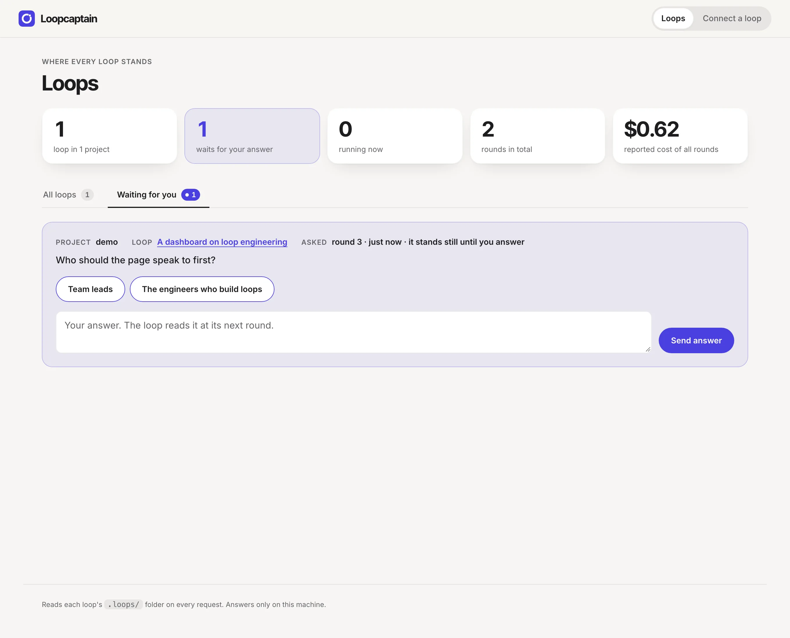
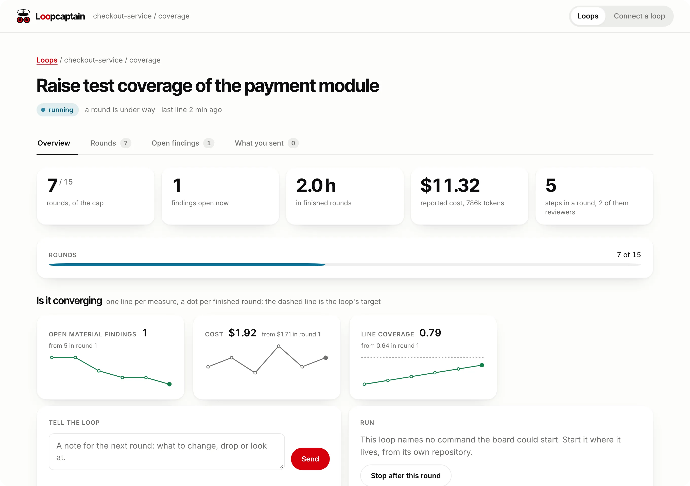
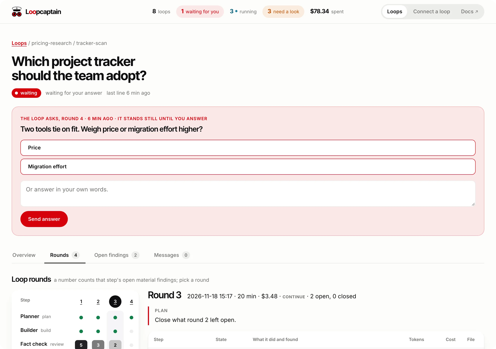
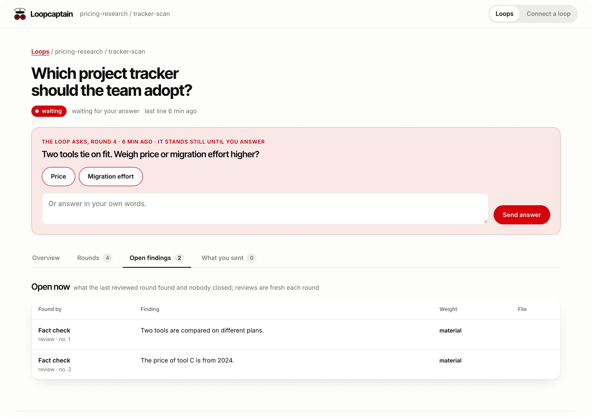
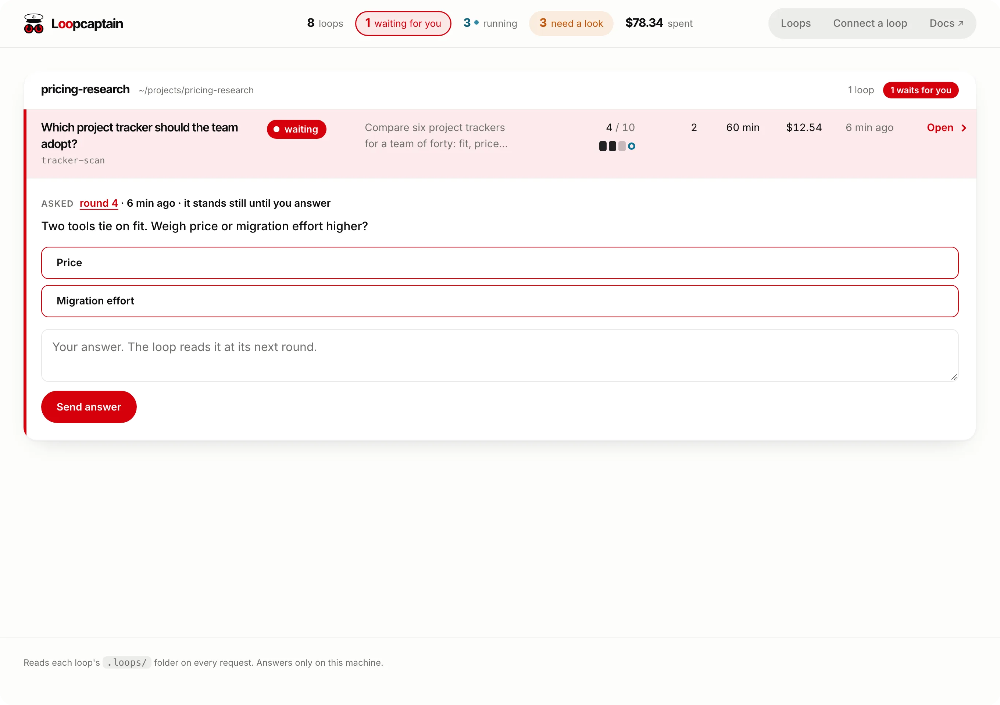

# The board

A local web page, on 127.0.0.1 only, that reads every watched loop's files
on each request. It keeps no state of its own besides its key and the
records of what it started.

The pictures on this page show invented loops.

## Pages

1. **Loops.** Every loop, grouped by repository, with status, rounds
   against the cap, the latest rounds as a strip, open findings, time and
   cost. Filter by text or
   status; finished loops fold away. The "Waiting for you" tab holds every
   question, with buttons where the loop offers options.
2. **One loop**, in tabs, each with its own address:
   1. *Overview*: key figures, bars against the caps, a line per measure
      ("is it converging"), signs of no progress, the steering card, the
      brief and the graph of a round.
   2. *Rounds*: every round against every step; the round you pick, with
      each step's summary, findings, cost, retries, errors and file.
   3. *Open findings*: what the last reviewed round left open.
   4. *Items*: what the loop evaluates, item by kind of check.
   5. *What you sent*: every inbox line, whether the loop took it, and
      whether this board wrote it.
3. **Connect a loop.** The two prompts, the standard, and the MCP line for
   the agent you pick.

{ width="49%" }
{ width="49%" }

{ width="49%" }
{ width="49%" }

## Where to look first

1. The tiles at the top count what waits for your answer, what runs, and
   what stalled or failed; a tile takes colour only when its count is not
   zero.
2. Every row carries a stripe in its status colour, and a row that needs
   you (a question, a failure) is tinted.
3. Beside the round count, a square per round: darker for more findings
   left open, a green dot for none, a ring while it runs.

## Steering

1. **Answer or note.** Appends a signed `reply` to the loop's
   `inbox.jsonl`; the loop reads it at its next round.
2. **Stop.** Appends a signed `stop`; the loop finishes its round and ends.
   Offered only where the loop may still start a round.
3. **Start.** Runs the `commands.start` the loop's own `loop.json` names, in
   its repository, without a shell, with only `PATH`, `HOME`, `LANG` and `TERM` from
   the board's environment, and `LOOPCAPTAIN_INBOX_KEY` naming the key the board signs
   with. The first start of a command in a repository asks for a tick.
4. **End the process now.** Only for a process the board started.

## Statuses

`new`, `running`, `sleeping` (said when it is back), `stalled` (a round
went silent), `waiting` (for you), `idle`, `done`, `stopped`, `capped`,
`failed`. Status is derived from the lines on every request, never stored.
