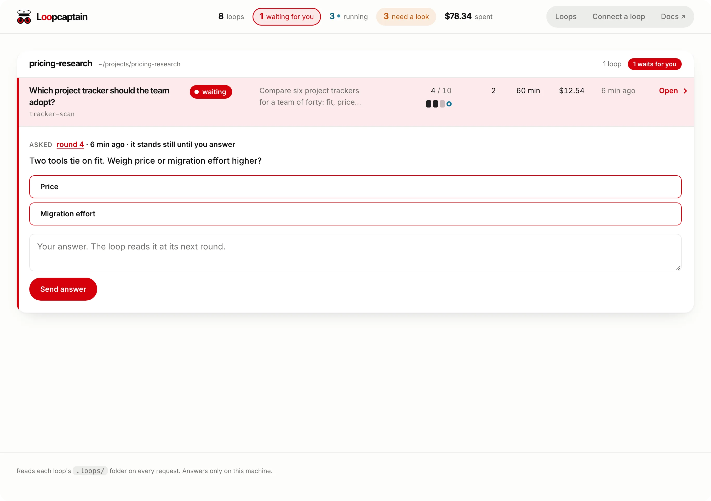

# Get started

Five minutes, no model, no network, no cost: run the example loop, steer
it from the board, then point the board at your own repositories.

You need the `loopcaptain` command: [Installation](installation.md).

## 1. Write the example loop

```bash
loopcaptain demo
```

This writes a small loop into `~/.local/share/loopcaptain/demo` and puts
it on the board. The loop builds a dashboard on loop engineering with
invented content and comes with two rounds of history.

## 2. Start the board

```bash
loopcaptain serve
```

Open <http://127.0.0.1:8484>. The board answers on this machine only.

## 3. Steer the loop

1. Open the loop. You see its brief, the graph of a round and the two
   rounds it has behind it.
2. Press **Start** and tick the box. The board runs the one command the
   loop declares in its own `loop.json`; the tick is asked once per
   command.
3. The loop asks a question. Answer it with one of its buttons, or in
   your own words.
4. It reads your answer at its next round, converges and ends `done`
   within seconds.

A question looks like this, here from an invented loop:



That is everything a connected loop does: it says what it is, what
happened and what it needs from you, and it reads what you send.

## 4. Watch your own repositories

```bash
loopcaptain watch ~/projects --root     # every repository under a folder
loopcaptain watch ~/projects/some-repo  # one repository
```

A repository shows up once it has a `.loops/` folder. Watch only
repositories you have read: Start runs what they declare.
[Setup](setup.md) has the details.

## 5. Connect a loop

Give your coding agent one of the two prompts on the [home page](index.md),
or follow [Connect or build a loop](connect.md) yourself.

## From a checkout

```bash
make setup && make demo && make serve
```

`make demo` writes the example into `demo/` in the checkout.
