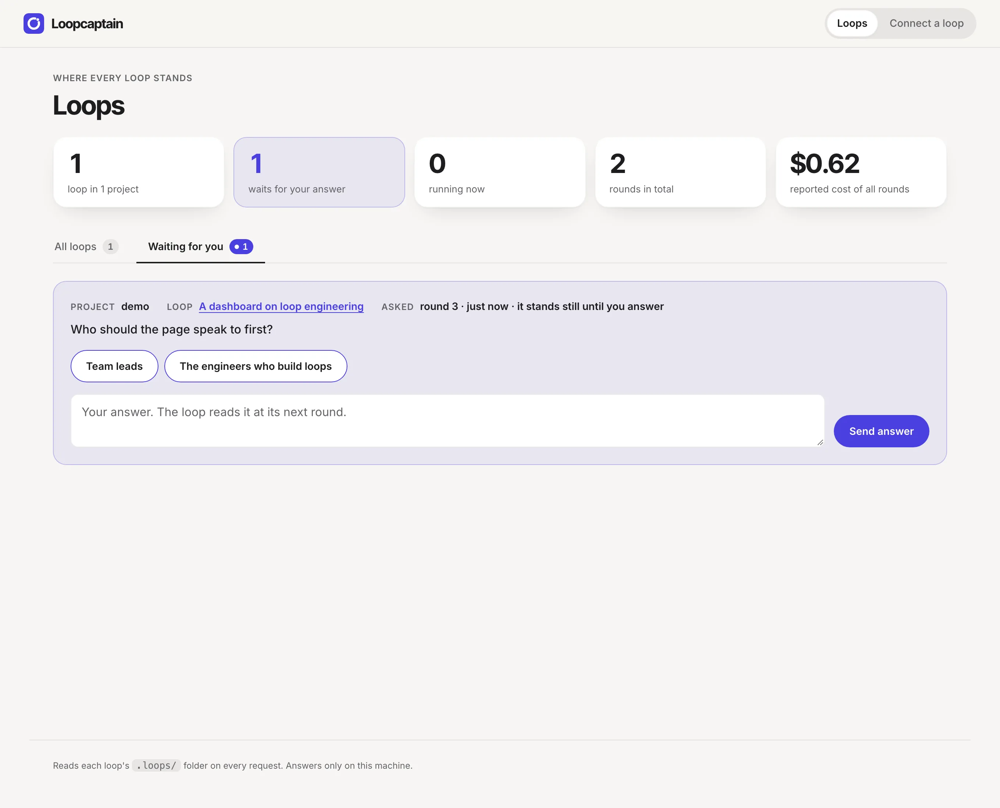
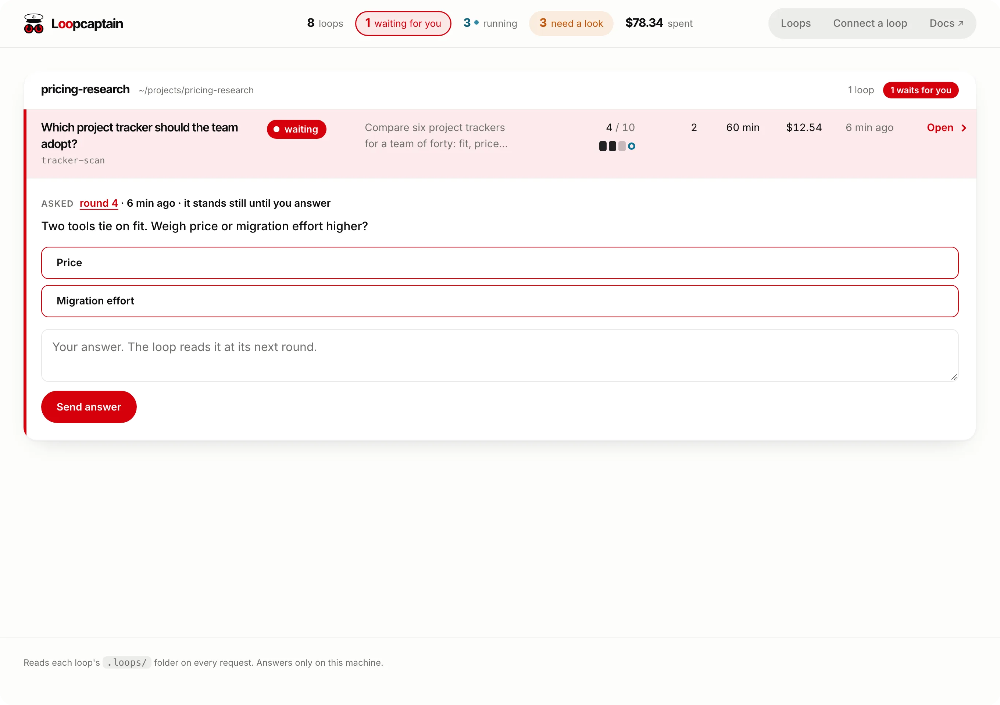
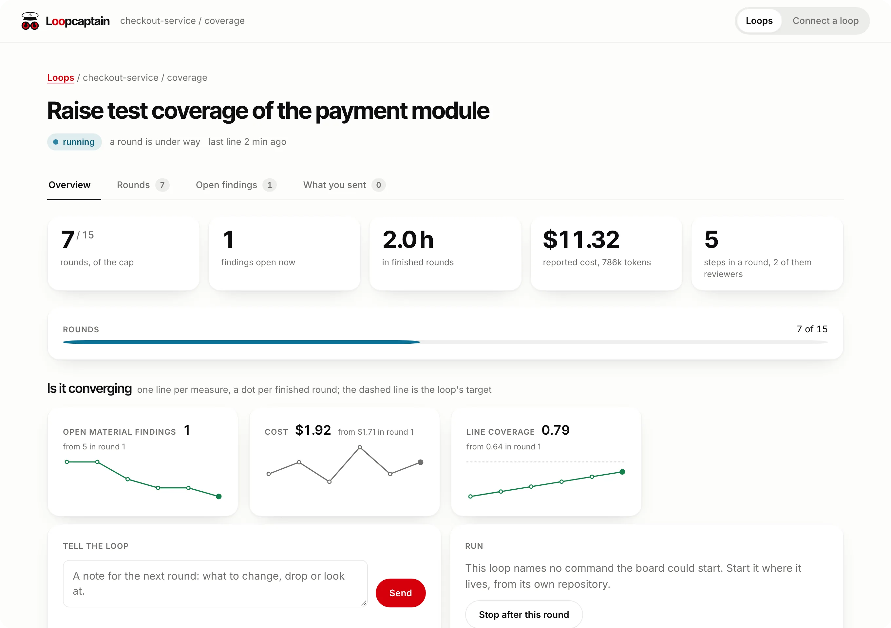
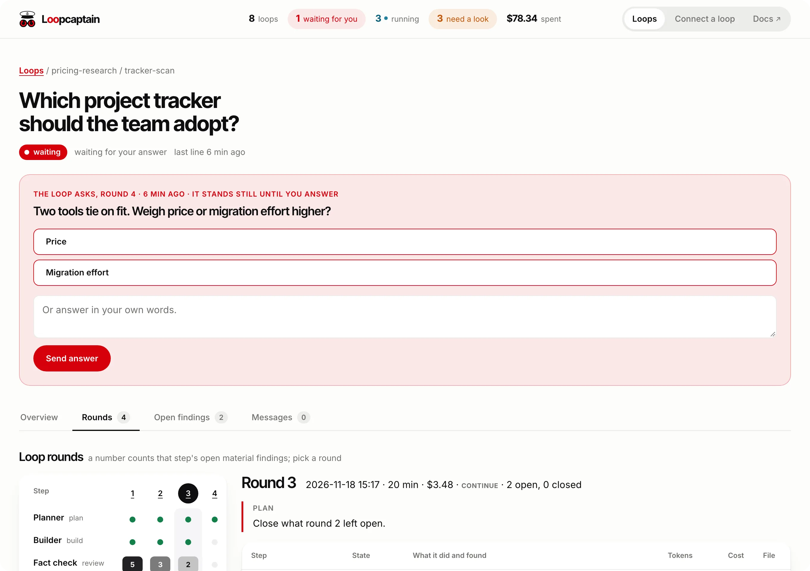
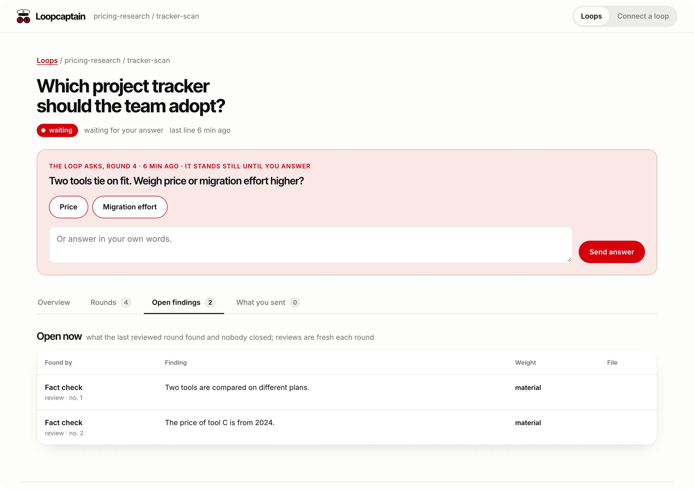

# Loopcaptain

**An open protocol for agent loops and a local dashboard to monitor and
steer them: one board for every agent loop.** A loop, in its own repository, writes a few small files; the board shows what it is for, where it stands, what
every round and reviewer found, what it cost, and what waits for you. You
answer and steer from the board.



Invented loops, photographed from the board itself.

## Get started

**Look first.** [Install it](installation.md) and [get started](get-started.md)
with the example loop, which costs nothing: no model, no network.

**Monitor the loops you already run.** Paste this into your coding
agent, whichever you use. It finds the loops on your machine, sets up the
board and proposes the smallest change that connects each one:

```text
--8<-- "standard/prompts/watch-my-loops.md"
```

**Set up a new loop that speaks the protocol.** Paste this one. It
asks what the loop is for, builds it in your repository and shows you one
real round on the board:

```text
--8<-- "standard/prompts/build-a-loop.md"
```

## What you see

{ width="49%" }
{ width="49%" }

{ width="49%" }
{ width="49%" }

[The board](board.md) walks through each page.

## How it works


