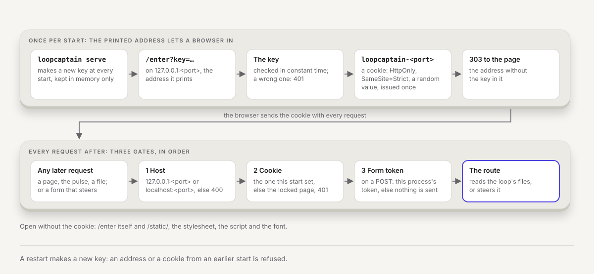
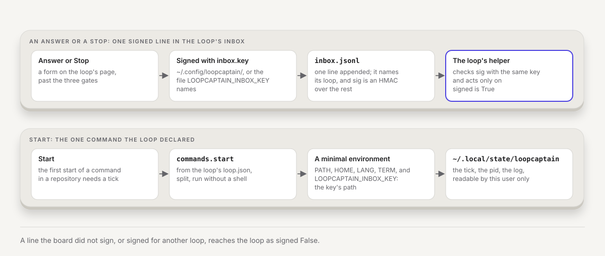

--8<-- "SECURITY.md:head"

<picture>
  <source media="(prefers-color-scheme: dark)" srcset="assets/entry-dark.svg">
  
</picture>

<picture>
  <source media="(prefers-color-scheme: dark)" srcset="assets/steer-dark.svg">
  
</picture>

--8<-- "SECURITY.md:model"
