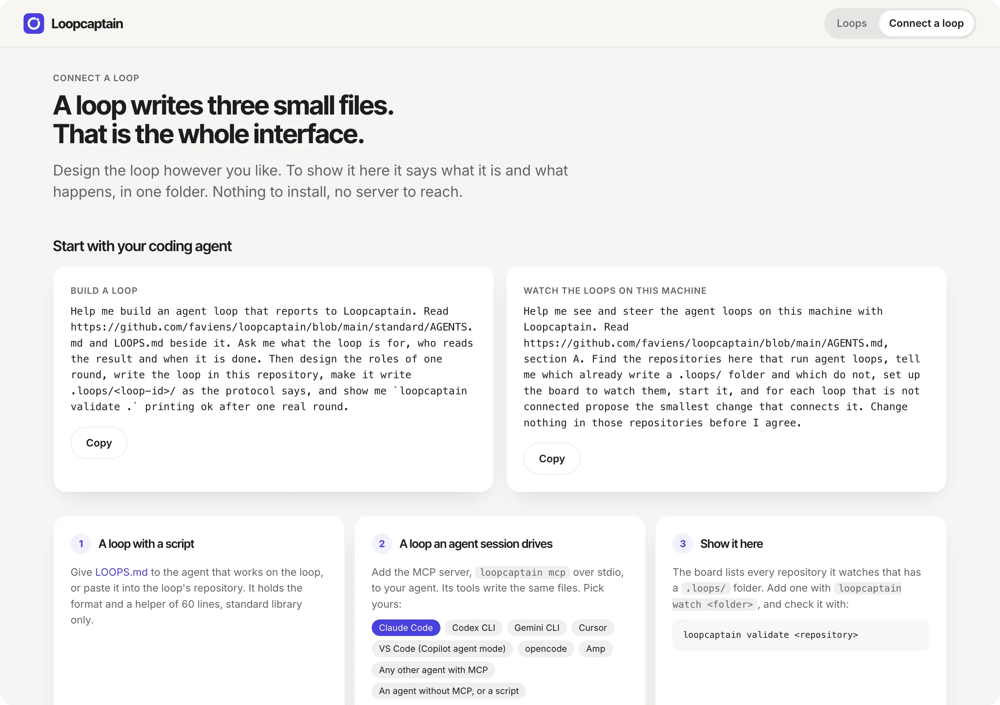

# Setup

How to set the board up for the loops on your machine: what to watch, how
to check a loop, how an agent session reports, and where to look when a
loop does not show.

## 1. Choose what the board watches

```bash
loopcaptain watch ~/projects --root     # every sub-folder with a .loops/ folder
loopcaptain watch ~/work/some-repo      # one repository
loopcaptain unwatch ~/work/some-repo
```

The commands edit `~/.config/loopcaptain/config.yaml`; you can edit it by
hand too, see [Configuration](reference/configuration.md). Worktrees of
one repository show once.

Every watched repository with a `.loops/` folder then appears on the
board's front page, grouped by repository:


!!! warning "Watch only repositories you have read"

    The board's Start button runs the command a loop declares in its own
    `loop.json`. A folder of repositories nobody has read does not belong
    on the board.

## 2. Check each loop

```bash
loopcaptain validate ~/work/some-repo          # problems and warnings in its .loops folders
loopcaptain doctor ~/work/some-repo <loop-id>  # with the loop running: does it take a stop?
```

`validate` reads; `doctor` sends a running loop a signed stop and passes
once the loop took it and ended.

## 3. Let agent sessions report

A loop with a script needs nothing installed. A loop that an agent
session drives reports through the MCP server:

```bash
loopcaptain mcp-config <agent>      # prints the line that adds the server to your agent
```

[Works with every agent](agents.md) lists each agent.

The board shows the same on its **Connect a loop** page: the two prompts
with a Copy button, and the line for the agent you pick.



## 4. Run the board

```bash
loopcaptain serve                   # http://127.0.0.1:8484
loopcaptain serve --port 9000
```

1. The board binds to 127.0.0.1 and accepts requests only for that host.
   It has no login because nothing outside the machine reaches it.
2. It reads the files again on every request and keeps no database. Stop
   it whenever you like; nothing is lost.
3. It runs only while you run it. To keep it up, leave it in a terminal
   or a terminal multiplexer.
4. Restart it after an upgrade.

## 5. On your phone

The board never listens beyond 127.0.0.1. To open it on a phone, let a
private network on this machine forward to it, such as
[Tailscale](https://tailscale.com) with Serve and HTTPS certificates
turned on for your tailnet, and Tailscale on the phone:

```bash
tailscale serve --bg http://127.0.0.1:8484
loopcaptain serve --host-name <machine>.<tailnet>.ts.net
```

1. Open `https://<machine>.<tailnet>.ts.net` on the phone. Only your
   tailnet's devices reach it; answers, notes and stops work as on the
   laptop. "Add to Home Screen" keeps it one tap away.
2. `--host-name` takes a plain name, no scheme, port or wildcard, and
   may be given more than once. Without it the board refuses the name.
3. Whoever can reach the name can steer your loops and press Start:
   share the machine with nobody on the tailnet you would not hand the
   laptop. Use `tailscale serve`, never `tailscale funnel`, which puts
   the board on the internet.
4. A sleeping laptop has no board, on any device.

## 6. Messages on your phone

`loopcaptain telegram` tells you on Telegram when a loop asks you
something, fails, goes silent or ends, and takes your answer back. It
calls Telegram and waits for replies; nothing on this machine listens.

1. Create a bot: message `@BotFather` in Telegram, send `/newbot`, keep
   the token it gives. Keep it in your password manager or keychain, not
   in a file in a repository.
2. Pair your chat, once:

   ```bash
   export LOOPCAPTAIN_TELEGRAM_TOKEN=<token>
   loopcaptain telegram --pair      # prints a code; send it to your bot
   ```

   The chat id goes into the config under `telegram.chats`. Only a
   private chat can pair, and only listed private chats are heard.
   Stop a running `loopcaptain telegram` before pairing (both would
   read the bot's updates) and start it again after.
3. Run it beside the board: `loopcaptain telegram`.

```yaml
telegram:
  chats: [123456789]
  text: minimal                          # or full
  board_url: https://<machine>.<tailnet>.ts.net
```

1. `text: minimal`, the default, sends the loop's name, repository,
   round and status, and a button to stop after this round. Telegram can
   read what a bot sends, so the question itself goes only with
   `text: full`, which adds its text and one button per choice; reply to
   the message to answer in words.
2. `board_url`, with the board on your phone (section 5), puts a link to
   the loop's page in each message.
3. A press or a reply goes through the same checks as the board's forms
   and ends in the same signed inbox line. A loop can not be started from
   a chat. Send `/status` for every loop's status.
4. Each piece of news goes out once; it is tried again while no chat
   could be reached, and a loop that stalls a second time in one round
   is news again; what was sent is kept in
   `telegram.json` in the board's state folder: `.state` in the folder
   it is started from, or `LOOPCAPTAIN_STATE`. Start it from the same
   folder each time, or it begins afresh.

## 7. The key your answers are signed with

The board signs every line it writes into a loop's `inbox.jsonl` with
`~/.config/loopcaptain/inbox.key`, made on first use. A loop that reads
the same key can refuse a stop or an answer the board did not write. A
loop the board starts gets the key's path as `LOOPCAPTAIN_INBOX_KEY`; a
loop you start yourself finds it in the default place.

## When a loop does not show

| What you see | Likely cause | Check |
|---|---|---|
| The repository is missing | it is not watched, or has no `.loops/` folder | `loopcaptain watch <repository>`, then reload |
| The loop shows as unreadable | `loop.json` does not follow the protocol | `loopcaptain validate <repository>` |
| `stalled` | a round is open and no line arrived for 45 minutes | the loop's own log; a loop that sleeps says so with `next_at` |
| Start is not offered | the loop declares no `commands.start` | its `loop.json` |
| Your answer is not taken | the loop does not read its inbox, or refuses an unsigned line | `loopcaptain doctor <repository> <loop-id>` |
| The port is taken | another board, or another program on 8484 | `loopcaptain serve --port <other>` |
