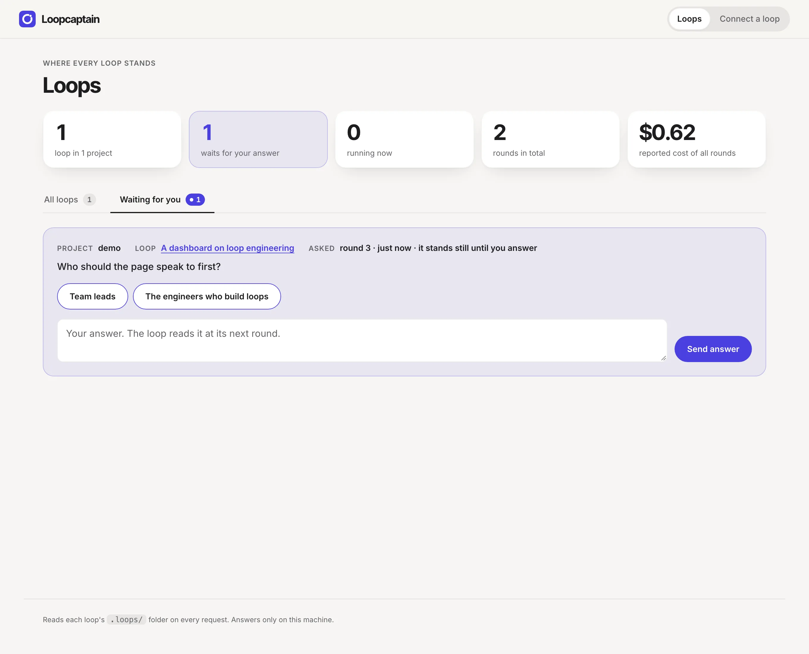
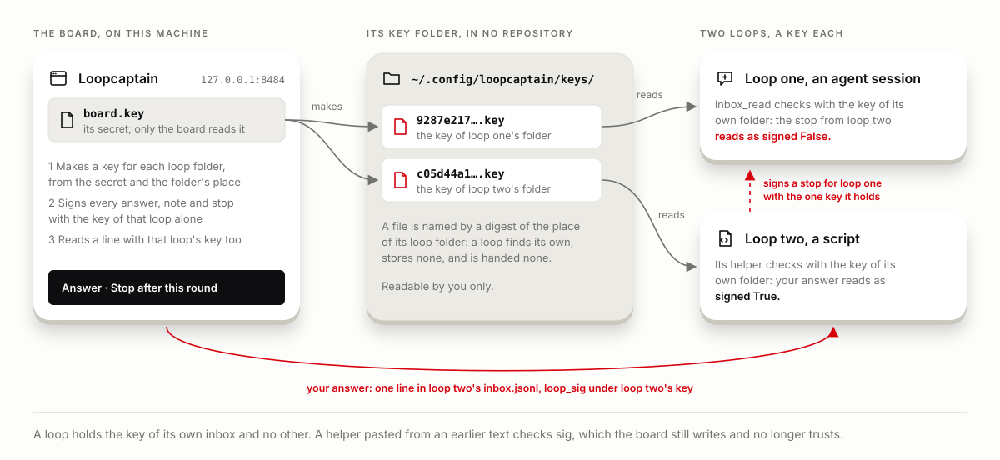

# Setup

How to set the board up for the loops on your machine: what to watch, how
to check a loop, how an agent session reports, and where to look when a
loop does not show.

## 1. Choose what the board watches

```bash
loopcaptain watch ~/projects --root     # every sub-folder with a .loops/ folder
loopcaptain watch ~/work/some-repo      # one repository
loopcaptain unwatch ~/work/some-repo
```

The commands edit `~/.config/loopcaptain/config.yaml`; you can edit it by
hand too, see [Configuration](reference/configuration.md). Worktrees of
one repository show once.

Every watched repository with a `.loops/` folder then appears on the
board's front page, grouped by repository:



!!! warning "Watch only repositories you have read"

    The board's Start button runs the command a loop declares in its own
    `loop.json`. A folder of repositories nobody has read does not belong
    on the board.

## 2. Check each loop

```bash
loopcaptain validate ~/work/some-repo          # problems and warnings in its .loops folders
loopcaptain doctor ~/work/some-repo <loop-id>  # with the loop running: does it take a stop?
```

`validate` reads; `doctor` sends a running loop a signed stop and passes
once the loop took it and ended.

## 3. Let agent sessions report

A loop with a script needs nothing installed. A loop that an agent
session drives reports through the MCP server:

```bash
loopcaptain mcp-config <agent>      # prints the line that adds the server to your agent
```

[Works with every agent](agents.md) lists each agent.

The board shows the same on its **Connect a loop** page: the two prompts
with a Copy button, and the line for the agent you pick.


## 4. Run the board

```bash
loopcaptain serve                   # prints the address to open, port 8484
loopcaptain serve --port 9000
```

<picture>
  <source media="(prefers-color-scheme: dark)" srcset="assets/entry-dark.svg">
  
</picture>

1. The board binds to 127.0.0.1 and accepts requests only for that host.
   It has no login: `serve` prints one line with the address to open,
   the number of repositories it watches and the config it read. Opening
   that address sets a session cookie in that browser; a browser without
   it sees a page that says where the address is. The key in the address
   is new at every start, so after a restart open the new address.
2. A port that is taken stops `serve` with one line that says so; start
   it with `--port <other>`.
3. It reads the files again on every request and keeps no database. Stop
   it whenever you like; nothing is lost.
4. It runs only while you run it. To keep it up, leave it in a terminal
   or a terminal multiplexer.
5. Restart it after an upgrade.

## 5. The key your answers are signed with

The board signs every line it writes into a loop's `inbox.jsonl` with a
key of that loop alone. The keys are files in the board's config folder,
never in a repository:

| File in `~/.config/loopcaptain/` | Holds | Read by |
|---|---|---|
| `board.key` | the secret every loop's key is made from, made when `serve` first starts | the board only |
| `keys/<name>.key` | the key of one loop folder; `<name>` is a digest of the folder's place | that loop, and the board |
| `keys/<name>.earlier` | the marks of the lines that loop's inbox held under the earlier key when its key was first made; nothing is added later | the board |
| `inbox.key` | the one key of earlier versions, still used for `sig` | a loop with a helper pasted before each loop had a key |

A loop stores no key. Its helper works out the name of its own file from
the place of its `.loops/<loop-id>/` folder and reads that file, so it
can refuse a stop or an answer the board did not write, and it cannot
sign for any other loop. The board writes a loop's file when it first
sees the loop, and before it starts it. A loop the board starts gets
`LOOPCAPTAIN_INBOX_KEY`, which says where the folder is and holds no key;
a loop you start yourself finds the default place. Moving a repository
gives its loops new keys: answers sent before the move then read as not
from the board.

<picture>
  <source media="(prefers-color-scheme: dark)" srcset="assets/keys-dark.svg">
  
</picture>

<picture>
  <source media="(prefers-color-scheme: dark)" srcset="assets/steer-dark.svg">
  
</picture>

## When a loop does not show

| What you see | Likely cause | Check |
|---|---|---|
| The repository is missing | it is not watched, or has no `.loops/` folder | `loopcaptain watch <repository>`, then reload |
| The loop shows as unreadable | `loop.json` does not follow the protocol | `loopcaptain validate <repository>` |
| `stalled` | a round is open and no line arrived for 45 minutes | the loop's own log; a loop that sleeps says so with `next_at` |
| Start is not offered | the loop declares no `commands.start` | its `loop.json` |
| Your answer is not taken | the loop does not read its inbox, or refuses an unsigned line | `loopcaptain doctor <repository> <loop-id>` |
| `serve` says the port cannot be used | another board, or another program on that port | `loopcaptain serve --port <other>` |
